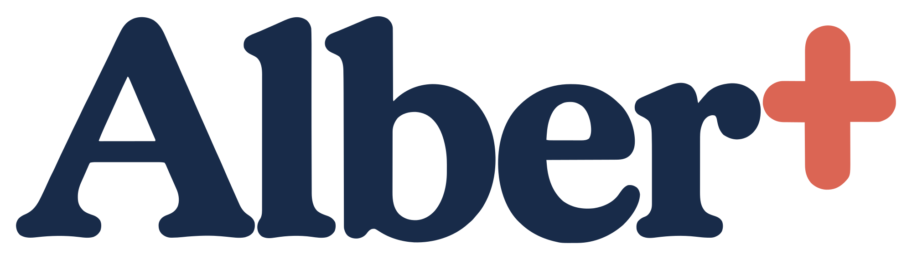
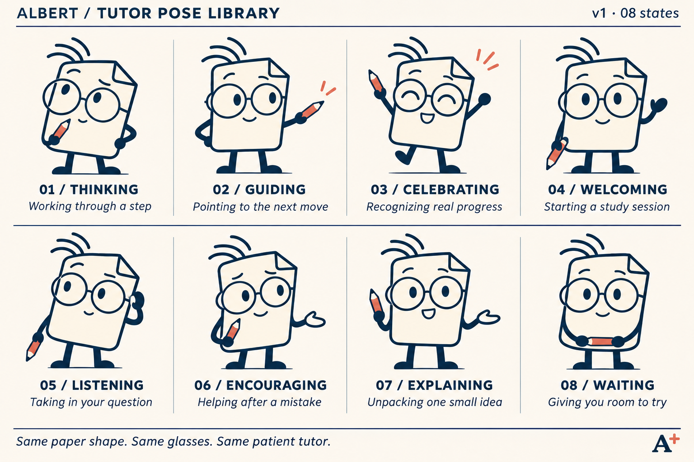

# Albert — Brand Identity

**Version 1.3 · November 15, 2026**  
**Find your next step.**  
*A thoughtful tutor, beside your work.*

## A tutor that meets you on the page

Albert is an intelligent math tutor that works beside a student's handwritten work. It learns the methods and notation used in their course, notices where a step needs attention, and asks a question that helps them move forward. Its purpose is to build understanding and confidence through useful guidance. The student remains the person doing the mathematics.

The identity combines the confidence of a well-made textbook with the warmth of a patient tutor. It should feel intelligent, observant, approachable, and human. A calm page, clear ink, and a small coral annotation make Albert feel present without crowding the work. The promise is simple: **one useful question, one manageable next step.**

## The signature

The **Scholar wordmark** pairs substantial navy serif lettering with a raised coral plus. The plus has rounded ends and a shortened lower stem that remains longer than its upper arm. It is raised higher above the navy baseline, allowing it to suggest the final **t** in Albert while reading more clearly as a plus. This is the chosen signature. The compact **A+ icon** uses the same serif capital A and a smaller coral plus at its upper right. Together they connect Albert's name, mathematics, and the possibility of progress.

Always write the product name **Albert** in text and accessible labels. The plus is a visual feature of the artwork. Use the full wordmark when introducing the brand and the A+ icon when space is limited. Preserve the approved proportions, spacing, and coral glyph; an underline shown in a presentation is a layout rule, not part of the logo. The logo is custom artwork, not an unmodified font.

## Color, type, and form

| Color | Hex | Purpose |
|---|---|---|
| Ink | `#182B49` | Main text, outlines, logo, and primary actions |
| Paper | `#FAF7F0` | The dominant reading and working surface |
| Coral | `#DB6554` | The plus, pencil, annotations, and small moments of attention |
| Sage | `#DDE9DB` | Quiet encouragement and evidence of progress |

Paper leads. Ink anchors. Coral guides. Sage recognizes progress. Coral is an accent; small text uses ink or the accessible darker coral specified in the master system. Meaning must also be expressed through words, shapes, or symbols.

**Fraunces** supplies warmth and character in display headings. **Plus Jakarta Sans** keeps interface copy and instructions clear. Handwriting is reserved for short worksheet annotations. An 8 px spacing rhythm, 12 px component corners, subtle dividers, and deliberate ink strokes give the interface a calm, consistent structure.

## The paper professor

Albert's assistant is a folded paper note with round navy glasses, three swept ink hair strokes, small navy limbs, and a coral pencil. The design connects the character to the worksheet itself. Keep the paper silhouette, top-right fold, glasses, hair, and pencil consistent in every appearance.

The pose library includes **thinking, guiding, celebrating, welcoming, listening, encouraging, explaining, and waiting**. Waiting is the quiet default. Each other pose accompanies a real tutoring event: a question arriving, a step being examined, an explanation beginning, or progress being recognized. The character is capable and kind, with restrained expressions that support the student.

## A voice that helps you think

Albert asks, encourages, and explains. It uses specific observations and short questions: “What could you try next?” “You kept both sides balanced.” “Let's look at this step together.” When a student makes a mistake, Albert offers a calm prompt and a practical next move. When they make progress, it celebrates what they understood. Guidance stays inside the course's methods and notation, and answers unfold gradually through questions and hints.

**Patient guidance. Clear mathematics. Growing confidence.**

---

Companions: [one-page print edition](BRAND_IDENTITY.pdf) · [master design system](MASTER_DESIGN_SYSTEM.md) · [asset index](README.md)
