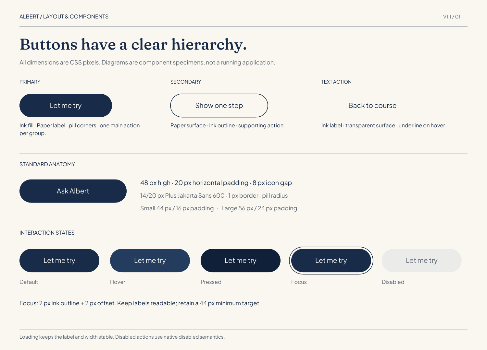
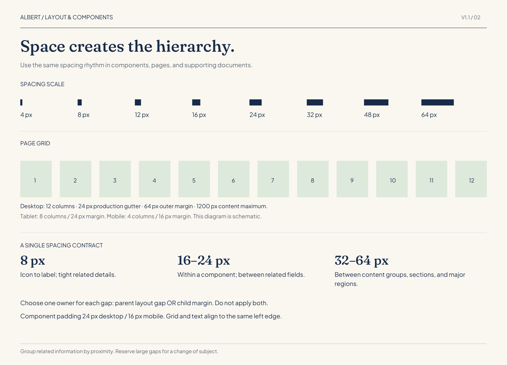
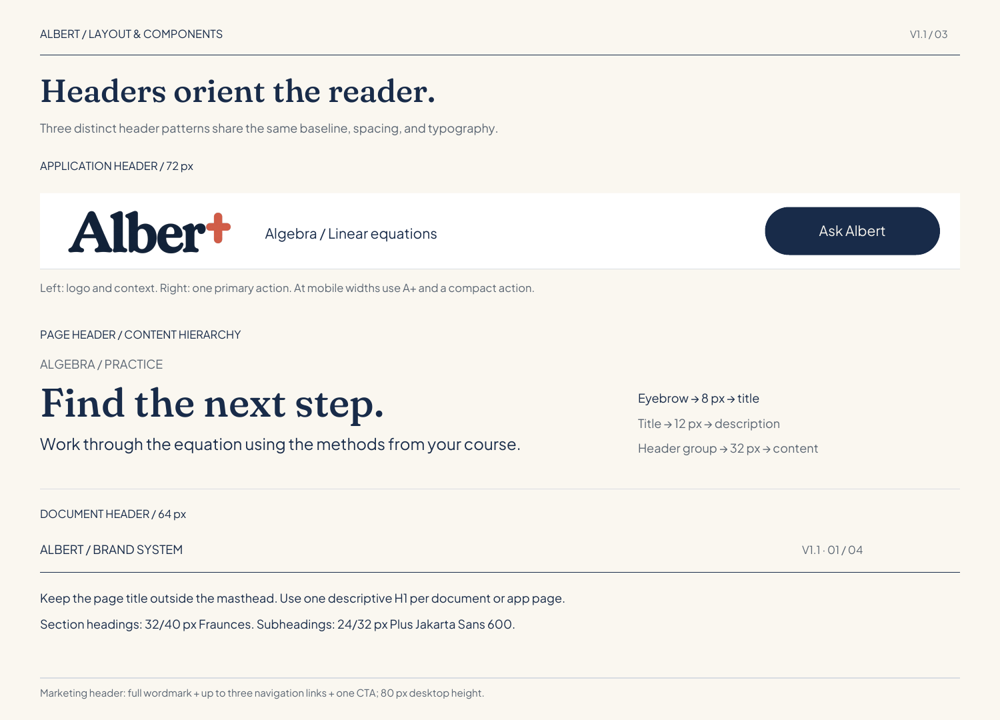
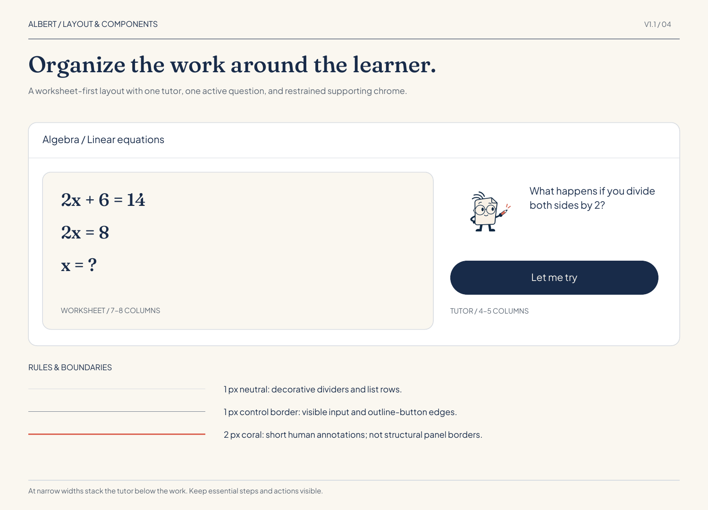
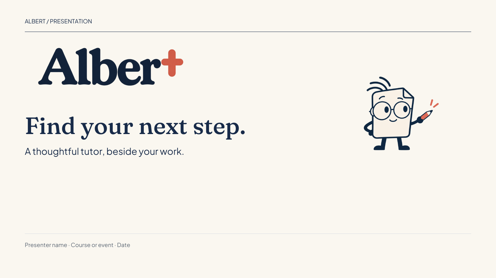
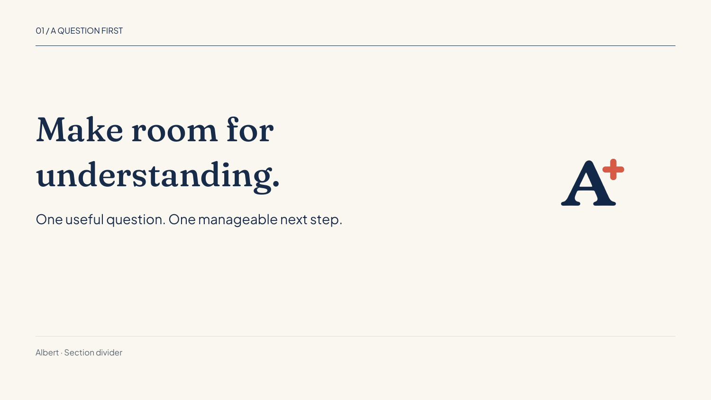
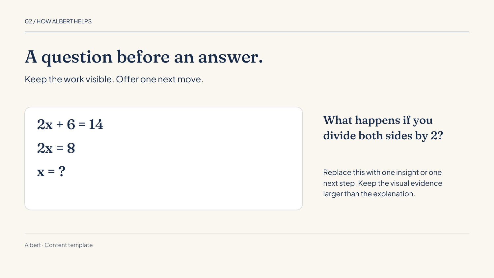

# Albert — Layout, Components, and Presentations

**Version 1.1.0 · November 15, 2026**

This specification turns the brand into repeatable buttons, page structures, headers, dividers, and slides. Use it alongside the [master design system](MASTER_DESIGN_SYSTEM.md). See the [four-page visual guide](LAYOUT_AND_COMPONENTS.pdf), [presentation reference PDF](templates/PRESENTATION_TEMPLATES.pdf), and [editable PowerPoint](templates/albert-presentation.pptx).

## 1. Revised wordmark


The final coral glyph now sits higher, with a shorter lower stem. Its top sits near the navy ascender height, and its bottom floats noticeably above the navy baseline. Rounded ends and a lower arm that remains longer than the upper arm preserve the t/plus dual reading. Treat the supplied image as the geometry master; do not independently reposition its glyph in application code. The compact A+ icon is unchanged.

## 2. Button formatting



### Sizes and anatomy

| Property | Small | Standard | Large |
|---|---|---|---|
| Minimum height | 44 px | 48 px | 56 px |
| Horizontal padding | 16 px | 20 px | 24 px |
| Vertical padding | 10 px | 12 px | 16 px |
| Label | 14/20 px, Plus Jakarta Sans 600 | Same | Same |
| Icon | 16 px | 18 px | 20 px |
| Icon-to-label gap | 8 px | 8 px | 8 px |
| Corner radius | Full pill | Full pill | Full pill |
| Border | 1 px, included in sizing | Same | Same |

Use `box-sizing: border-box`. Height is a minimum: translated or wrapped labels may increase it. Use content-width buttons; do not force all labels to the width of the longest button. A narrow-screen primary action may fill its container intentionally. A 44 px icon-only control has a 44 px accessible target even when the visible icon is smaller.

### Hierarchy

- **Primary:** Ink fill, Paper label, transparent border. Use for one main action within the current task, such as “Let me try.”
- **Secondary:** Paper fill, Ink label and Ink outline. Use for an alternative such as “Show one step.”
- **Text action:** transparent fill, Ink label, underline on hover and focus. Use for lower-emphasis navigation.

Place related actions in one row with a **12 px gap**. In a tutor bubble, show the main next action first in reading order, then the alternative. On narrow screens, wrap or stack them while preserving that order. Keep confirmation-dialog primary actions last in reading order when that matches the platform convention. The dominant action must be clear in either arrangement.

### States

| State | Treatment |
|---|---|
| Default | Core variant colors |
| Hover | Primary `#243D5E`; secondary `#EEECE6`; no layout movement |
| Pressed | Primary `#102039`; preserve readable text |
| Keyboard focus | 2 px Ink outline, 2 px offset; works independently of hover |
| Disabled | `#EBECE9` fill, Muted label, native `disabled` semantics |
| Loading | Maintain button width and label; show real status nearby or append an indicator |

Do not make Coral the default filled-button color: its text contrast is insufficient for the usual normal-size Paper or Ink labels. Use actual `<button>` elements for actions and anchors for navigation. Loading should not create repeated announcements or remove the user's keyboard focus.

## 3. Spacing, grids, and alignment



### Spacing contract

| Distance | Use |
|---|---|
| 4 px | Fine alignment and tightly connected small details |
| 8 px | Icon to label; eyebrow to title; related metadata |
| 12 px | Between buttons; title to supporting description |
| 16 px | Mobile component padding; compact field groups |
| 24 px | Desktop component padding; related content blocks; desktop grid gutter |
| 32 px | Page-header group to first content block |
| 48 px | Between sections on a compact page |
| 64 px | Between major sections and minimum desktop outer margins |

The parent owns spacing through `gap` whenever possible. Do not apply a child margin and a parent gap for the same relationship. Remove browser-default heading and paragraph margins inside the component layout. Use fewer, larger coherent groups rather than many arbitrary spacer values.

### Responsive grid

| Viewport | Columns | Gutter | Minimum side margin |
|---|---:|---:|---:|
| Desktop, 1200 px and wider | 12 | 24 px | 64 px |
| Tablet, 768–1199 px | 8 | 24 px | 24 px |
| Mobile, below 768 px | 4 | 16 px | 16 px |

The content maximum is **1200 px**. Center it. For example, a 1440 px viewport produces 120 px side margins because the centered content reaches its maximum. At 1280 px, 64 px side margins leave a 1152 px content area. Do not confuse minimum outer margins with a fixed value at every viewport width.

Align the page title, primary content, and section headings to the same content edge. Within a component, align text with its own padding edge. Align numeric columns consistently. Centered layouts belong mainly to simple announcement pages; long teaching content is left aligned.

## 4. Lines, borders, and handwritten marks

| Line | Specification | Use |
|---|---|---|
| Decorative divider | 1 px `#D9DDE2`, solid | Section separators and list rows |
| Input boundary | 1 px `#7A8592`, solid | An interactive field that needs a visible edge |
| Secondary-button outline | 1 px Ink, solid | Alternate action |
| Focus outline | 2 px Ink, 2 px offset | Keyboard interaction |
| Worksheet annotation | Approximately 2 px Coral, rounded cap | A short ring, underline, or arrow |
| Document masthead rule | 0.5–0.75 pt Ink in print | Identity pages and presentation headers |

Use a divider **or** a large gap to separate closely related groups; avoid repeatedly using both inside a small component. Structural dividers are straight, neutral, and quiet. Handwritten marks are short, specific, and slightly organic. Do not turn every card border coral or use wavy lines as application scaffolding.

Use **16 px above and below** a divider within a component and **24 px above and below** between document subsections. A line should span its parent content width or deliberately align to a text column. It must not accidentally run through a heading, logo, annotation, or active writing area.

## 5. Headers and typography hierarchy



### Application header

- **72 px desktop height; 64 px mobile height.** Use Paper or White, with a single neutral bottom rule.
- Place the wordmark at the left, course/task context after a **24 px gap**, and the primary action at the right.
- Use a wordmark canvas width of approximately **184 px**; judge the visible artwork, accounting for its transparent margins.
- Center controls vertically. Put actions in a wrapping group with **12 px gaps**.
- On mobile, use the compact A+ icon and move course context into the page header if necessary. Do not squeeze all text into one line or hide the primary action behind the mascot.

### Marketing header

Use an **80 px** desktop header with the full wordmark, up to three concise navigation links, and one primary CTA. Use a **64 px** mobile header and a real accessible menu when navigation does not fit. Keep navigation copy in Plus Jakarta Sans 14/20 px, weight 500 or 600. Reserve the display face for content headings.

### Page-header group

1. Optional short eyebrow: 12/18 px, UI face, weight 600, Muted.
2. **8 px gap** to the H1: 40/48 px Fraunces 500 on desktop; 32/40 px on mobile.
3. **12 px gap** to the description: 16/24 px UI face, readable width near 60–70 characters.
4. **32 px gap** from the whole group to the first content section.

Use one descriptive H1. A section heading uses 32/40 px Fraunces 500; a subheading uses 24/32 px Plus Jakarta Sans 600. Keep a heading with the content it introduces. Avoid all-caps multi-line headings and excessive italic styling in the product UI.

### Document masthead

Use a small label at the upper left such as “ALBERT / BRAND SYSTEM.” Put version, section, or page number at the right. Keep the masthead within a roughly **64 px** top band, then draw a quiet Ink rule below it. Put the main page title beneath the masthead rather than compressing it into the navigation strip. For A4 print, use roughly **16 mm** page margins and adjust type sizes for the medium.

## 6. How pieces are organized



### The page stack

Use this order: **application header → page-header group → main task region → related supporting material**. A footer is optional. Within each region, put the title or context first, then the evidence or work, then the relevant controls. Keep the primary question close to the symbol or step it describes.

### Component anatomy

A typical bounded component uses **24 px desktop padding / 16 px mobile padding**, **12 px corner radius**, and an optional 1 px neutral border. Its internal order is: heading, supporting context if needed, main content, then action group. Use **16 px** between these parts. Do not nest a filled card inside another filled card unless the inner element is a distinct interactive field.

Use Paper as the dominant page surface and White only where a quiet surface distinction helps. Avoid adding shadows to every panel. A list should generally use aligned rows and thin separators instead of a stack of independent cards. A form keeps labels and messages next to their fields, with **8 px label-to-field spacing** and **24 px between field groups**. Inputs are at least **48 px high**, with **16 px horizontal padding** and a **12 px radius**.

### Worksheet and tutor

Give the work area roughly **7–8 desktop columns** and the tutor **4–5 columns**, depending on the actual task. Keep a **24 px gutter**. The tutor holds one mascot, one current question or explanation, and a concise action group. A focused white/Paper panel may bound the worksheet; handwriting and annotations remain the central evidence.

Below tablet widths, stack the tutor below the relevant work or open it deliberately in a bottom panel. Do not cover live strokes or important symbols. Preserve the question text if the mascot is hidden. Use larger gaps to separate a new mathematical idea, not a proliferation of decorative panels.

## 7. Title slides and presentation templates



Files: [editable PowerPoint](templates/albert-presentation.pptx) · [three-page PDF](templates/PRESENTATION_TEMPLATES.pdf).

The templates use **16:9**, sized **13⅓ × 7½ inches** in PowerPoint and **960 × 540 pt** in the PDF reference. Text and basic shapes are editable in PowerPoint; the wordmark, icon, and mascot remain embedded PNGs. Fraunces and Plus Jakarta Sans must be installed for an exact PowerPoint text match. The PDF embeds its fonts and provides the visual reference.

### Title slide

- **48 pt safe margin** on left and right; keep the top masthead and bottom metadata aligned to it.
- Small 11 pt masthead at the upper left, then a 0.5–0.75 pt Ink rule.
- Approved wordmark above the main title, with enough clearspace; never type the logo manually.
- One short **46/56 pt Fraunces** title, usually a maximum of two lines.
- One **18/26 pt** UI subtitle, ideally one line or two short lines.
- One supporting mascot at the right, separated from the title. Keep the title column under approximately two-thirds of the slide width.
- A footer rule and **11 pt** presenter/event/date line. Do not add a primary CTA button unless the slide is an interactive interface.

### Section-divider slide



Use a section number and topic in the masthead, one **46 pt** title, one optional **18 pt** supporting sentence, and the A+ icon as a restrained side accent. Keep the same outer margins and footer position. This slide introduces an idea; it should not contain a paragraph or an image gallery.

### Content slide



Use a **34/42 pt** Fraunces title, a short **17/25 pt** lead if needed, and a simple two-column content region. Give the visual evidence approximately **60%** of the usable width and the explanation **30%**, leaving the remainder as the gutter. A diagram, worksheet, or screenshot should be readable without zooming. Use one main insight and at most three supporting points. General presentation body copy should be at least **18 pt** where possible; the template's smaller 14 pt note is a replaceable secondary caption, not a model for dense body slides.

### Things that stay aligned

Across slides, preserve the masthead baseline, rule endpoints, title left edge, main content edges, and footer baseline. Change content, not the grid. Use Coral for a focused annotation or the logo; keep paragraph text in Ink. Avoid decorative charts or invented metrics to fill space.

## 8. Applying the system

The supplementary stylesheet [albert.components.css](tokens/albert.components.css) implements these foundational classes. It uses [albert.css](tokens/albert.css) variables, plus the v1.1 layout/control tokens. It contains no JavaScript and is not a working menu, modal, or tutoring interface. Load fonts through the application's normal setup.

```html
<main class="albert-page albert-stack">
  <header class="albert-page-heading">
    <p class="albert-eyebrow">Algebra / Practice</p>
    <h1>Find the next step.</h1>
    <p>Work through the equation using your course methods.</p>
  </header>

  <section class="albert-panel albert-stack" aria-label="Tutor guidance">
    <p>What happens if you divide both sides by 2?</p>
    <div class="albert-actions">
      <button class="albert-button albert-button--primary" type="button">Let me try</button>
      <button class="albert-button albert-button--secondary" type="button">Show one step</button>
    </div>
  </section>
</main>
```

When adding a new component, specify its spacing, typography, states, focus behavior, and mobile reflow using this same system. Check it with real text, a long label, keyboard focus, and a narrow viewport before treating it as production-ready.
