# Albert — Master Design System

**Version 1.3.0 · November 15, 2026**  
Owner: Albert · Product context: [Azrkiel/albert](https://github.com/Azrkiel/albert)

This is the working reference for Albert's brand, interface foundations, teaching voice, and mascot behavior. It consolidates the chosen Scholar wordmark, raised rounded coral plus, serif A+ icon, original palette, and eight-pose paper professor. The independent [Brand Identity document](BRAND_IDENTITY.md) explains the complete brand in prose; its [print companion](BRAND_IDENTITY.pdf) is exactly one page.

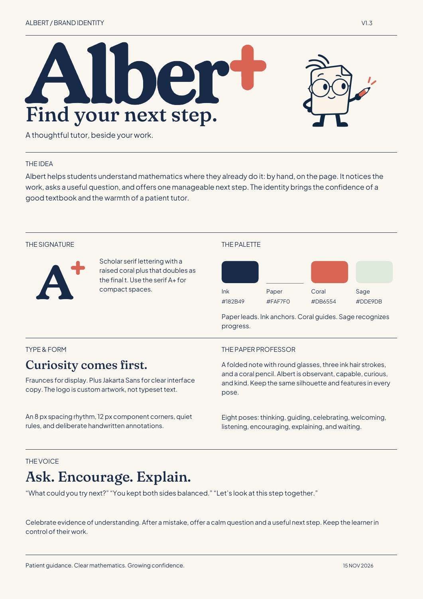

## Contents

1. [Brand foundation](#1-brand-foundation)
2. [Logo system](#2-logo-system)
3. [Color system](#3-color-system)
4. [Typography](#4-typography)
5. [Spacing, form, and composition](#5-spacing-form-and-composition)
6. [Interface components](#6-interface-components)
7. [Worksheet and annotation behavior](#7-worksheet-and-annotation-behavior)
8. [Mascot character model](#8-mascot-character-model)
9. [Pose library](#9-pose-library)
10. [State behavior and motion](#10-state-behavior-and-motion)
11. [Voice and teaching language](#11-voice-and-teaching-language)
12. [Accessibility and responsive behavior](#12-accessibility-and-responsive-behavior)
13. [Implementation and asset handoff](#13-implementation-and-asset-handoff)
14. [Detailed layout, components, and presentations](#14-detailed-layout-components-and-presentations)
15. [Complete website system](#15-complete-website-system)
16. [Production assets and screen handoff](#16-production-assets-and-screen-handoff)

## 1. Brand foundation

### Product and promise

Albert is a course-aware math tutor working directly with handwritten worksheets. It follows the student's notation, highlights a specific part of their work, and helps them reason toward the next step. Its teaching sequence starts with a useful question, then reveals progressively more support when requested. It keeps guidance within the methods the course has covered.

**Positioning:** an intelligent tutor beside your work.  
**Primary tagline:** Find your next step.  
**Supporting line:** A thoughtful tutor, beside your work.  
**Teaching promise:** One useful question. One manageable next step.

### Personality expressed through design

| Quality | What a student experiences | Design expression |
|---|---|---|
| Intelligent | The hint addresses their actual step | Precise annotation, clear hierarchy, Scholar serif |
| Patient | Time and room to reason | Quiet waiting pose, restrained motion, generous space |
| Approachable | Asking for help feels comfortable | Warm paper, rounded plus, paper professor |
| Observant | Their methods and notation matter | Local comments beside relevant work |
| Encouraging | Progress is specific and understandable | Sage feedback and evidence-based celebration |

### Source of truth

The standalone files in this package are the distribution assets. The current identity board reflects the production package and retains the raised-t wordmark refinement; the original v1.0 board is retained as a historical reference. The pose board is the character reference. The Markdown specifications and token files govern new interface work when a rendered reference contains illustrative inconsistencies. Earlier handwritten-a logos and earlier serif-ended coral crosses are superseded. New work uses the chosen serif A+ and the plain rounded coral plus/t.

## 2. Logo system

### Primary Scholar wordmark

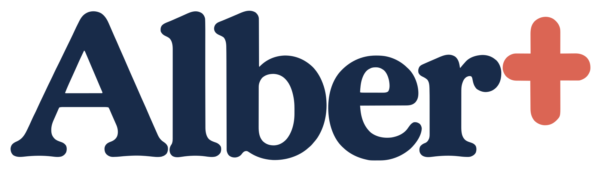

Production master: [albert-wordmark-primary.svg](assets/logos/vector/albert-wordmark-primary.svg). Matching PNG/PDF and mono/reverse variants are included.

The navy portion spells **Alber** in warm, substantial serif lettering. One coral ending glyph completes the signature. It uses two intersecting strokes with rounded ends, a short upper arm, a longer lower stem, and a more pronounced lift above the text baseline. In v1.1 the lower stem is shorter, still longer than the top arm, and the bottom floats clearly above the navy letter feet. This glyph communicates both **t** and **+**. Preserve its relationship to the preceding r.

Use the full wordmark on onboarding, landing pages, document covers, and headers with sufficient space. Read and label it **Albert**. Do not write “Alber+” in normal sentences, screen-reader labels, page titles, or search metadata.

### Compact A+ icon


Production master: [albert-icon-primary.svg](assets/logos/vector/albert-icon-primary.svg). Matching PNG/PDF and mono/reverse variants are included.

The icon uses a serif capital A and a smaller coral plus at the upper right. Use it for compact navigation, app identity, and favicons. The icon's plus is a normal balanced plus; the wordmark's ending has the elongated lower stroke. They share rounded terminals and the same coral identity without needing identical proportions.

### Placement and size

These are starting implementation rules; verify them at the final rendered size.

| Property | Rule |
|---|---|
| Wordmark clearspace | At least 25% of its visible capital-A height on every side |
| Icon clearspace | At least 20% of its visible A height |
| Wordmark minimum | 144 px visible width digitally; 32 mm in print |
| Icon minimum | 24 px visible width; check any 16 px favicon raster separately |
| Background | Paper or another quiet, light neutral surface |
| Aspect ratio | Preserve the supplied image's ratio; scale uniformly |
| Alignment | Align to visible letterforms, accounting for transparent canvas margins |

The images include transparent margin. Clearspace is measured from the visible artwork, not the PNG boundary. Additional space is appropriate in a cover or masthead.

### Color variants and restrictions

The production bundle supplies primary, mono Ink, reverse Paper/Coral, and mono Paper masters in SVG, PNG, and PDF. Use reverse or mono Paper on Ink backgrounds. The SVGs contain editable paths rather than embedded raster images. The original PNGs remain as concept/source references.

Do not recreate the wordmark by typing a stock font, replace the final glyph with a serif cross, add a second t or plus, stretch the logo, add an annotation circle, or attach the mascot to the logo as a permanent lockup. The thin baseline visible in some boards is a presentation rule and is absent from the actual logo file.

## 3. Color system

### Core palette

| Token | Name | Hex | Main use |
|---|---|---|---|
| `--albert-ink` | Ink | `#182B49` | Main text, primary actions, logo, illustration contours |
| `--albert-paper` | Paper | `#FAF7F0` | Primary application and worksheet surface |
| `--albert-coral` | Coral | `#DB6554` | Logo plus, pencil, annotation strokes, small attention cues |
| `--albert-sage` | Sage | `#DDE9DB` | Supportive success surface |
| `--albert-muted` | Muted | `#5A6572` | Secondary text and labels |

Paper occupies most of a typical screen. Ink establishes hierarchy and primary actions. Coral appears in focused moments; avoid making every control coral. Sage is a quiet feedback surface and always pairs with readable Ink text.

### Functional extensions

| Token | Value | Purpose |
|---|---|---|
| `--albert-coral-text` | `#A63D30` | Accessible darker coral for small warning or annotation text |
| `--albert-border` | `#D9DDE2` | Subtle decorative dividers; not a sole interactive boundary |
| `--albert-control-border` | `#7A8592` | Visible boundary for inputs and outlined controls |
| `--albert-white` | `#FFFFFF` | Optional clean card surface against Paper |

These extensions support interface behavior; the four core brand colors remain unchanged. The illustration files retain their hand-drawn tonal texture; exact HEX tokens apply to new interface fills and text.

### Measured contrast

Ratios below were computed from the sRGB HEX values using WCAG relative luminance. Raster illustration pixels vary slightly and should not carry essential text.

| Foreground / background | Ratio | Intended use |
|---|---:|---|
| Ink / Paper | 13.26:1 | Body text and headings |
| Paper / Ink | 13.26:1 | Primary button labels |
| Muted / Paper | 5.55:1 | Secondary normal-size text |
| Ink / Sage | 11.31:1 | Positive feedback text |
| Coral Text / Paper | 5.89:1 | Small annotation or error text |
| Coral / Paper | 3.27:1 | Graphic annotations; not normal-size text |
| Paper / Coral | 3.27:1 | Avoid for normal-size button labels |
| Ink / Coral | 4.05:1 | Avoid for normal-size button labels |

Pair success with a check and specific text. Pair an error with an explicit description and correction path. A coral ring identifies a place to inspect; it does not by itself mean “wrong.”

## 4. Typography

### Families

| Role | Family | Weights | Use |
|---|---|---|---|
| Display | Fraunces | 500, 600 | Headlines, section titles, short editorial phrases |
| Interface | Plus Jakarta Sans | 400, 500, 600 | Navigation, body copy, buttons, labels, feedback |
| Optional ink annotation | Caveat | 400, 500 | Short nonessential handwritten notes |
| Math | The application's math renderer | Appropriate math fonts | Live equations and accessible mathematical notation |

The Scholar logo is custom image artwork, not an exact Fraunces typesetting recipe. Do not rebuild it from the display font. Fraunces and Plus Jakarta Sans are bundled under their OFL licenses in `assets/fonts/`; use the optional `albert.fonts.css` loader. Caveat is optional and is not bundled. Sources: [Fraunces](https://fonts.google.com/specimen/Fraunces), [Plus Jakarta Sans](https://fonts.google.com/specimen/Plus+Jakarta+Sans), [Caveat](https://fonts.google.com/specimen/Caveat).

### Type scale

| Role | Size / line height | Weight |
|---|---|---|
| Hero | 48 / 56 px | Fraunces 500 |
| Page title | 40 / 48 px | Fraunces 500 |
| Section heading | 32 / 40 px | Fraunces 500 |
| Subheading | 24 / 32 px | Plus Jakarta Sans 600 |
| Lead paragraph | 18 / 28 px | Plus Jakarta Sans 400 |
| Body and input | 16 / 24 px | Plus Jakarta Sans 400 |
| Label and button | 14 / 20 px | Plus Jakarta Sans 600 |
| Caption | 12 / 18 px | Plus Jakarta Sans 400 |

At narrow widths, reduce hero and page-title text to 32 / 40 px. Keep paragraphs comfortably under about 70 characters per line. Use sentence case for product copy. All-caps labels belong to compact brand-document labels, not long student-facing instructions. Italic serif typography in a concept board is editorial styling; actual tutoring messages use the readable interface face.

## 5. Spacing, form, and composition

### Tokens

| Category | Values |
|---|---|
| Spacing | 4, 8, 12, 16, 24, 32, 48, 64 px |
| Common rhythm | 8 px; 4 px for fine alignment |
| Corners | 8 px small; 12 px standard; 24 px large; 999 px pill |
| Rules | 1 px; use functional border contrast when identifying a control |
| Shadow | None by default; reserve subtle elevation for overlays |
| Interactive target | At least 44 × 44 px where practical |

Keep the worksheet dominant. Place explanations close to the work they reference, but outside the student's active writing area. Group related controls with spacing before adding another container. Prefer a single clear action to a cluster of equally emphasized buttons.

The mascot is a supporting presence. Use roughly 80–144 px visible height in a tutor panel and larger art only for onboarding or brand documents. Check the actual visible artwork, since PNG margins differ. Navigation may omit the mascot entirely. Lucide-style icons with consistent 1.5–2 px strokes work well with the interface; the mascot remains the distinctive illustration.

## 6. Interface components

| Component | Anatomy and styling | Behavior |
|---|---|---|
| Primary button | Ink fill, Paper label, pill radius | One dominant action such as “Let me try” |
| Secondary button | Paper surface, Ink label, visible control border | Supporting action such as “Show one step” |
| Text action | Ink label, underline or clear interactive treatment | Low-emphasis navigation or dismissal |
| Input | Paper or White surface, Ink text, label, control border, 12 px radius | Persistent label, visible focus, clear validation |
| Tutor message | Clear sans copy beside mascot; optional Paper bubble | One short question or one explanation at a time |
| Success feedback | Sage fill, Ink check and text | Name the specific step or skill demonstrated |
| Error feedback | Dark coral text with explicit description | Explain what needs attention and how to proceed |
| Skill progress | Neutral track, Ink filled portion, readable label | Label evidence and status; do not imply certainty without it |
| Worksheet tools | Familiar pen, eraser, undo, and selection actions | Visible selected state, labels or accessible names |

### Shared control states

Default controls use the palette above. Hover should produce a subtle change without moving the layout. Keyboard focus uses a 2 px Ink outline with a 2 px offset; it must remain visible on the current surface. Pressed states retain legible labels. Disabled actions have explicit disabled semantics and should explain the dependency when it is not obvious. Loading actions display real status text such as “Preparing a hint…” and prevent duplicate submissions only when necessary.

Do not communicate selected, disabled, invalid, or successful states through color alone. Provide a local message near the associated action. Announce completed asynchronous updates through a polite live region; avoid announcing the mascot's purely decorative changes.

## 7. Worksheet and annotation behavior

The worksheet is the student's space. Albert marks a specific symbol or step with a thin coral ring, underline, or short arrow. An annotation has an associated plain-language question or explanation. Keep new writing clear of existing strokes and provide a way to dismiss or revisit the hint.

### Teaching example

```text
Student work:
2x + 6 = 14
2x = 8
x = ?

Albert marks the coefficient 2:
“What happens if you divide both sides by 2?”

Actions:
Show one step     Let me try
```

If the student asks for one step, show the operation on both sides and explain it. Keep any subsequent reveal deliberate. The purpose of this example is to model a question before an answer, consistent notation, and local guidance.

Preserve the current course's symbols, methods, and level. Avoid interpreting a pause as an error. Where course context or handwriting is uncertain, ask a concrete question rather than inventing certainty: “Is that a 2 or a z?” The listening or encouraging pose can accompany the clarification, depending on the actual conversation.

## 8. Mascot character model

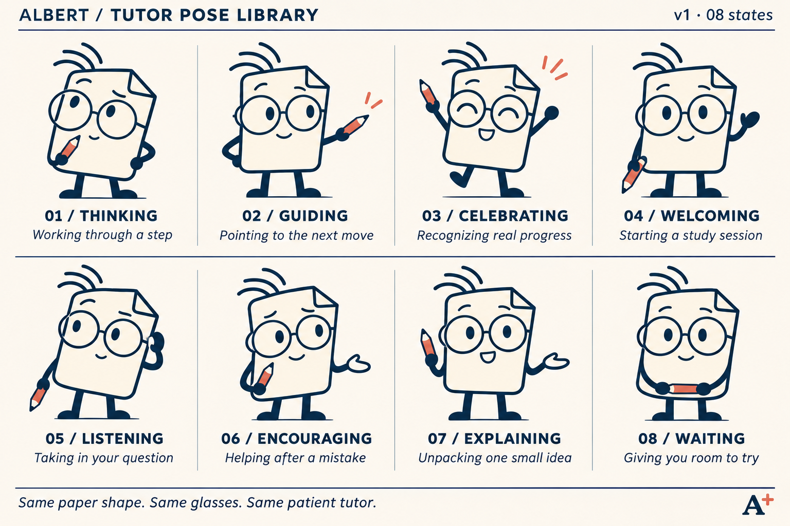

### Features to preserve

- One ivory paper body with a folded **top-right** corner and softly rounded lower corners.
- Exactly **three** swept navy hair strokes.
- Large round wire-frame navy glasses, a short bridge, and expressive eyes visible through the lenses.
- Small eyebrows and a kind mouth; the paper is the head and body together.
- Short navy limbs and simple rounded hands and feet.
- One coral pencil with a light sharpened point and dark graphite tip.
- A flat editorial drawing style with restrained Ink, Paper, and Coral colors.

Keep the top-right fold on the same side. Do not mirror the whole illustration to change its pointing direction; select an appropriate pose or commission a new right/left drawing. Do not add a hat, bow tie, separate head, dramatic costume, or extra limbs. The standalone PNGs are the intended pose assets; use them without redraws for normal interface implementation.

## 9. Pose library

Each thumbnail links to its independent transparent PNG. A printable [pose review sheet](MASCOT_POSES.pdf) is also included.

| Thinking | Guiding | Celebrating | Welcoming |
|---|---|---|---|
| [](assets/mascot/normalized/512/albert-thinking.png) | [](assets/mascot/normalized/512/albert-guiding.png) | [](assets/mascot/normalized/512/albert-celebrating.png) | [](assets/mascot/normalized/512/albert-welcoming.png) |

| Listening | Encouraging | Explaining | Waiting |
|---|---|---|---|
| [](assets/mascot/normalized/512/albert-listening.png) | [](assets/mascot/normalized/512/albert-encouraging.png) | [](assets/mascot/normalized/512/albert-explaining.png) | [](assets/mascot/normalized/512/albert-waiting.png) |

### State definitions

| State | Visual cue | Enter when | Suggested copy | Exit when |
|---|---|---|---|---|
| `thinking` | Pencil near cheek, gaze upward | Albert is genuinely processing a submitted request | “Looking at this step…” | A response, clarification, cancellation, or failure arrives |
| `guiding` | Pencil points toward the work | A hint identifies a specific step or symbol | “What could you try here?” | Student returns to work or requests an explanation |
| `celebrating` | Raised arms, smiling eyes | Evidence confirms a successful step or skill | “You kept both sides balanced.” | The acknowledgement completes or is dismissed |
| `welcoming` | A small greeting wave | A study session begins | “What are we working on today?” | The student begins a task or asks a question |
| `listening` | Attentive lean and sideward gaze | Albert is receiving input or asking for clarification | “Which part feels unclear?” | Input is submitted or the clarification is resolved |
| `encouraging` | Supportive open palm, kind expression | A specific mistake or expressed difficulty needs support | “Let's look at this step together.” | A targeted hint or student attempt begins |
| `explaining` | Pencil upright, open presenting hand | The student requests a concept or a worked step | “Let's take one small step.” | The explanation finishes or the student resumes |
| `waiting` | Pencil held quietly across the body | The student is working independently | “Take your time.” | A new actual tutoring event occurs |

The pose expresses the system's current action and conversational context. Do not infer an emotional state from handwriting, a pause, or a missing answer. Encouragement should be respectful and specific. A student who needs another attempt should never receive an angry, disappointed, or embarrassed character.

## 10. State behavior and motion

### Suggested event flow

```text
Session starts → welcoming → waiting
Question submitted → thinking → guiding → waiting
Clarification needed → listening → thinking → guiding
Explanation requested → thinking → explaining → waiting
Mistake identified → encouraging → guiding → waiting
Progress confirmed → celebrating → waiting
Request cancelled → waiting
Request fails → listening + an honest error message
```

These are implementation recommendations; the package contains static images, not running state-machine code or animation files. Let the active teaching task determine the pose. A new question interrupts a celebration. An explicit request for explanation replaces a guiding pose. A confirmed mistake receives support before any celebration. Do not stack several poses or show one character per message.

### Motion guidance

Use a short, restrained crossfade of about 160–200 ms when changing static images. Do not run constant bouncing, idle waving, or repeated celebrations. As an initial behavior, a brief celebration may return to waiting after roughly two seconds; any text remains readable and available. Processing states must be tied to actual work and include status text. If a request fails, show a useful retry path rather than continuing to display “thinking.”

Honor `prefers-reduced-motion`: switch poses immediately and omit decorative movement. Preserve focus and the student's writing position. The full tutoring experience must remain understandable if images do not load or motion is disabled.

## 11. Voice and teaching language

Albert speaks as a patient tutor: direct, curious, specific, and respectful. Prefer one short question before a longer explanation. Refer to the student's work and its mathematical relationship. Keep terminology aligned to their course.

| Situation | Preferred wording | Avoid |
|---|---|---|
| Starting | “What are we working on today?” | An oversized welcome speech |
| First hint | “What changes if you subtract 6 from both sides?” | Giving the full solution immediately |
| Mistake | “Let's check what happened to the sign here.” | “Wrong.” or “This is easy.” |
| Clarification | “Is that a 2 or a z?” | Claiming to read an ambiguous symbol confidently |
| Progress | “You applied the operation to both sides.” | Vague praise without evidence |
| Independent work | “Take your time. I'm here when you need a hint.” | Repeated unsolicited nudges |
| Service failure | “I couldn't prepare that hint. Try again.” | Pretending the student caused the problem |

Button labels describe the next action: **Ask Albert**, **Show one step**, **Let me try**, **Try again**. Use contractions naturally. Avoid shame, exaggerated certainty, competitive grade pressure, or claims that every task is effortless. A+ is the brand symbol; the teaching goal is understanding.

## 12. Accessibility and responsive behavior

- Maintain at least 4.5:1 contrast for normal text and 3:1 for large text and meaningful UI graphics, with appropriate exceptions for brand artwork. Use the contrast table when choosing text pairs.
- Make every action keyboard accessible with a visible focus state. Keep touch targets around 44 × 44 px and prevent adjacent targets from overlapping.
- Provide text equivalents for canvas annotations and relevant handwritten expressions. Render equations in an accessible math format when possible.
- When the adjacent text already explains the event, use `alt=""` for the mascot. If it carries otherwise missing meaning, provide a brief functional alternative such as “Albert is preparing a hint.”
- Use **Albert** as the wordmark's accessible name. Avoid reading a stylized glyph as “Alber plus.”
- Avoid flashing, repeated motion, surprise overlays, or feedback that depends only on color or sound.
- Keep essential instructions in live text rather than inside image assets.

### Responsive worksheet layout

At desktop widths, the work area and tutor panel can sit beside each other; retain a generous writing region. Below approximately 768 px, move tutor content below the relevant work or into a deliberately opened bottom panel. At very narrow widths, the A+ icon can replace the full wordmark. The mascot may become a small supporting thumbnail. Avoid covering symbols, toolbar controls, or the student's active stroke. Support 320 px layouts and text zoom without clipped controls.

## 13. Implementation and asset handoff

### Files

```text
albert-brand-kit/
├── README.md
├── BRAND_IDENTITY.md
├── BRAND_IDENTITY.pdf
├── MASTER_DESIGN_SYSTEM.md
├── MASCOT_POSES.pdf
├── PRODUCTION_ASSETS.md
├── ASSET_REVIEW.pdf
├── qa/  (browser report, visual baselines, and email captures)
├── WEBSITE_SYSTEMS_PLAN.md
├── WEBSITE_SYSTEMS.md
├── WEBSITE_SYSTEMS.pdf
├── COMPONENT_CATALOG.md
├── PRODUCTION_CHECKLIST.md
├── VERIFICATION.md
├── reference/  (index.html, styles.css, logic.js, app.js)
├── tests/  (logic.test.cjs)
├── LAYOUT_AND_COMPONENTS.md
├── LAYOUT_AND_COMPONENTS.pdf
├── templates/
│   ├── albert-presentation.pptx
│   └── PRESENTATION_TEMPLATES.pdf
├── CHANGELOG.md
├── assets/
│   ├── manifest.json
│   ├── icons/  (SVG, ICO, touch/app icons, and webmanifest)
│   ├── social/  (sharing images and PDF master)
│   ├── layout/  (seven visual specification pages)
│   ├── website/  (four website-system illustration pages)
│   ├── fonts/  (Fraunces, Plus Jakarta Sans, and OFL notices)
│   ├── logos/
│   │   ├── albert-wordmark.png
│   │   └── albert-icon.png
│   ├── mascot/
│   │   ├── albert-thinking.png
│   │   ├── albert-guiding.png
│   │   ├── albert-celebrating.png
│   │   ├── albert-welcoming.png
│   │   ├── albert-listening.png
│   │   ├── albert-encouraging.png
│   │   ├── albert-explaining.png
│   │   └── albert-waiting.png
│   └── reference/
│       ├── brand-identity-board.png
│       └── mascot-pose-board.png
└── tokens/
    ├── albert.css
    ├── albert.tokens.json
    ├── albert.components.css
    ├── albert.web.css
    └── albert.fonts.css
```

The PNG assets have real transparency and are intended for light surfaces. They are raster exports prepared from the established visual references (with the v1.1 wordmark refinement), not editable vector originals. They are not perfectly identical traced crops of the boards. The v1.3 production bundle adds SVG/PDF logo outlines, reverse and monochrome exports, website/app/social sizes, 32 aligned pose exports, an eight-cell sprite, and one one-shot WebP crossfade. Layered mascot drawing files and skeletal animation rigs are not included. Preserve the originals and derive further sizes from these masters. Review very small renders before shipping.

The original pose canvases have different aspect ratios and margins. For UI work, use the new normalized square exports in 128/256/512/1024 px sizes, with common paper scale and standing baseline. Preserve aspect ratio and use `object-fit: contain`. The included crossfade is not a rigged character animation. The included manifest records each image's actual dimensions, transparency, and state identifier.

### CSS usage

```css
@import url('./tokens/albert.css');

.tutor-message {
  color: var(--albert-ink);
  background: var(--albert-paper);
  font-family: var(--albert-font-ui);
  padding: var(--albert-space-4);
  border-radius: var(--albert-radius-md);
}

.tutor-mascot {
  width: 144px;
  height: 144px;
  object-fit: contain;
}
```

Load `tokens/albert.fonts.css` to use the bundled licensed display/UI fonts, then `albert.css`, `albert.components.css`, and `albert.web.css`. The plain foundation token stylesheet provides values; the component stylesheets provide presentation. Interactive reference behavior lives in `reference/app.js`.

### Markup usage

```html


<!-- Give the surrounding layout an appropriate rendered size. -->
<div class="tutor-message">
  
  <p>What happens if you divide both sides by 2?</p>
</div>
```

### Release notes

Version 1.3 preserves the raised-t identity and expands the website system with production vector/identity exports, aligned mascot assets and motion, editable responsive screen masters, communication templates, and browser/visual QA evidence. Color/spacing values and behavioral rules in this document are the proposed implementation baseline. The reference boards remain illustrative concepts. This package does not claim that the product UI, accessibility behavior, or animation system has already been implemented.


## 14. Detailed layout, components, and presentations

The specifications below are also provided in the standalone [layout guide](LAYOUT_AND_COMPONENTS.md), [four-page visual PDF](LAYOUT_AND_COMPONENTS.pdf), and [editable presentation](templates/albert-presentation.pptx).

### 1. Revised wordmark


The final coral glyph now sits higher, with a shorter lower stem. Its top sits near the navy ascender height, and its bottom floats noticeably above the navy baseline. Rounded ends and a lower arm that remains longer than the upper arm preserve the t/plus dual reading. Treat the supplied image as the geometry master; do not independently reposition its glyph in application code. The compact A+ icon is unchanged.

### 2. Button formatting

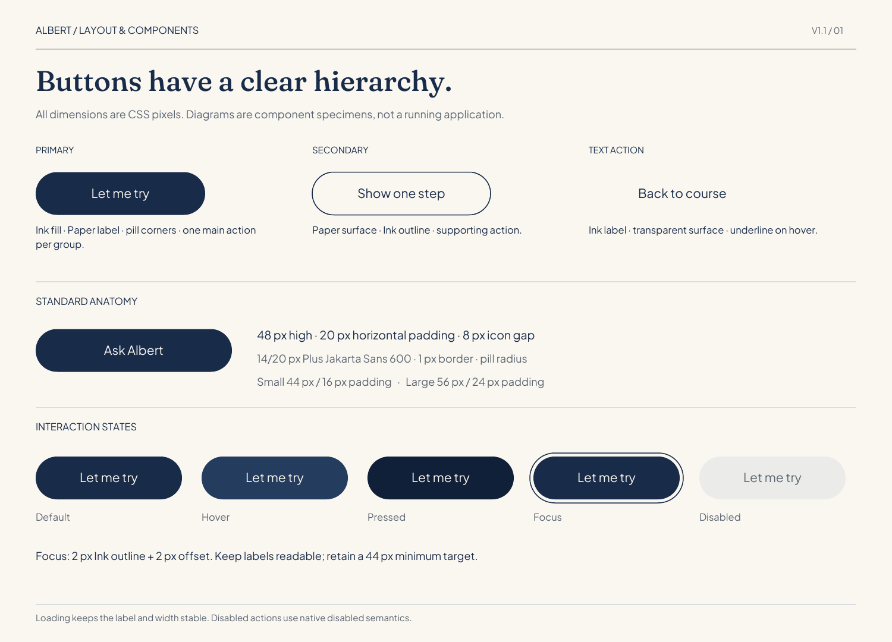

#### Sizes and anatomy

| Property | Small | Standard | Large |
|---|---|---|---|
| Minimum height | 44 px | 48 px | 56 px |
| Horizontal padding | 16 px | 20 px | 24 px |
| Vertical padding | 10 px | 12 px | 16 px |
| Label | 14/20 px, Plus Jakarta Sans 600 | Same | Same |
| Icon | 16 px | 18 px | 20 px |
| Icon-to-label gap | 8 px | 8 px | 8 px |
| Corner radius | Full pill | Full pill | Full pill |
| Border | 1 px, included in sizing | Same | Same |

Use `box-sizing: border-box`. Height is a minimum: translated or wrapped labels may increase it. Use content-width buttons; do not force all labels to the width of the longest button. A narrow-screen primary action may fill its container intentionally. A 44 px icon-only control has a 44 px accessible target even when the visible icon is smaller.

#### Hierarchy

- **Primary:** Ink fill, Paper label, transparent border. Use for one main action within the current task, such as “Let me try.”
- **Secondary:** Paper fill, Ink label and Ink outline. Use for an alternative such as “Show one step.”
- **Text action:** transparent fill, Ink label, underline on hover and focus. Use for lower-emphasis navigation.

Place related actions in one row with a **12 px gap**. In a tutor bubble, show the main next action first in reading order, then the alternative. On narrow screens, wrap or stack them while preserving that order. Keep confirmation-dialog primary actions last in reading order when that matches the platform convention. The dominant action must be clear in either arrangement.

#### States

| State | Treatment |
|---|---|
| Default | Core variant colors |
| Hover | Primary `#243D5E`; secondary `#EEECE6`; no layout movement |
| Pressed | Primary `#102039`; preserve readable text |
| Keyboard focus | 2 px Ink outline, 2 px offset; works independently of hover |
| Disabled | `#EBECE9` fill, Muted label, native `disabled` semantics |
| Loading | Maintain button width and label; show real status nearby or append an indicator |

Do not make Coral the default filled-button color: its text contrast is insufficient for the usual normal-size Paper or Ink labels. Use actual `<button>` elements for actions and anchors for navigation. Loading should not create repeated announcements or remove the user's keyboard focus.

### 3. Spacing, grids, and alignment

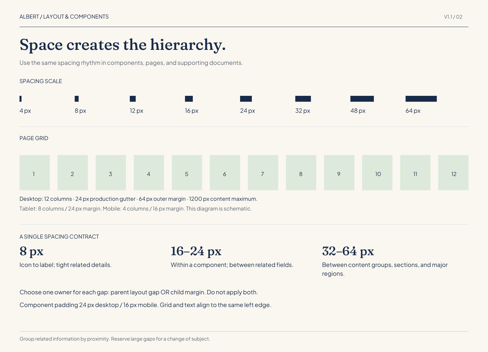

#### Spacing contract

| Distance | Use |
|---|---|
| 4 px | Fine alignment and tightly connected small details |
| 8 px | Icon to label; eyebrow to title; related metadata |
| 12 px | Between buttons; title to supporting description |
| 16 px | Mobile component padding; compact field groups |
| 24 px | Desktop component padding; related content blocks; desktop grid gutter |
| 32 px | Page-header group to first content block |
| 48 px | Between sections on a compact page |
| 64 px | Between major sections and minimum desktop outer margins |

The parent owns spacing through `gap` whenever possible. Do not apply a child margin and a parent gap for the same relationship. Remove browser-default heading and paragraph margins inside the component layout. Use fewer, larger coherent groups rather than many arbitrary spacer values.

#### Responsive grid

| Viewport | Columns | Gutter | Minimum side margin |
|---|---:|---:|---:|
| Desktop, 1200 px and wider | 12 | 24 px | 64 px |
| Tablet, 768–1199 px | 8 | 24 px | 24 px |
| Mobile, below 768 px | 4 | 16 px | 16 px |

The content maximum is **1200 px**. Center it. For example, a 1440 px viewport produces 120 px side margins because the centered content reaches its maximum. At 1280 px, 64 px side margins leave a 1152 px content area. Do not confuse minimum outer margins with a fixed value at every viewport width.

Align the page title, primary content, and section headings to the same content edge. Within a component, align text with its own padding edge. Align numeric columns consistently. Centered layouts belong mainly to simple announcement pages; long teaching content is left aligned.

### 4. Lines, borders, and handwritten marks

| Line | Specification | Use |
|---|---|---|
| Decorative divider | 1 px `#D9DDE2`, solid | Section separators and list rows |
| Input boundary | 1 px `#7A8592`, solid | An interactive field that needs a visible edge |
| Secondary-button outline | 1 px Ink, solid | Alternate action |
| Focus outline | 2 px Ink, 2 px offset | Keyboard interaction |
| Worksheet annotation | Approximately 2 px Coral, rounded cap | A short ring, underline, or arrow |
| Document masthead rule | 0.5–0.75 pt Ink in print | Identity pages and presentation headers |

Use a divider **or** a large gap to separate closely related groups; avoid repeatedly using both inside a small component. Structural dividers are straight, neutral, and quiet. Handwritten marks are short, specific, and slightly organic. Do not turn every card border coral or use wavy lines as application scaffolding.

Use **16 px above and below** a divider within a component and **24 px above and below** between document subsections. A line should span its parent content width or deliberately align to a text column. It must not accidentally run through a heading, logo, annotation, or active writing area.

### 5. Headers and typography hierarchy

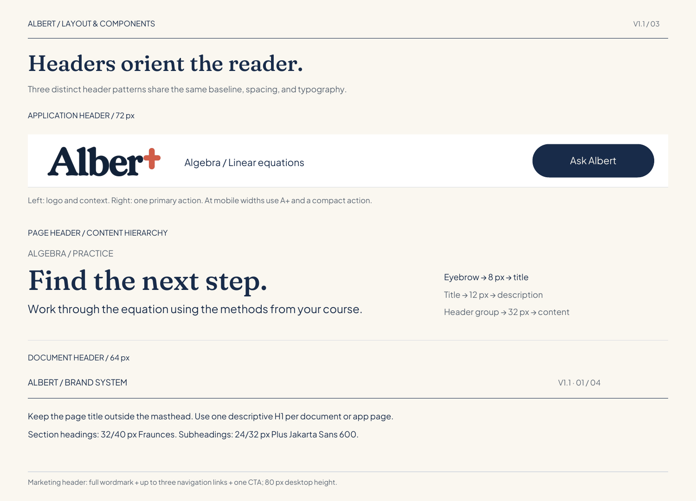

#### Application header

- **72 px desktop height; 64 px mobile height.** Use Paper or White, with a single neutral bottom rule.
- Place the wordmark at the left, course/task context after a **24 px gap**, and the primary action at the right.
- Use a wordmark canvas width of approximately **184 px**; judge the visible artwork, accounting for its transparent margins.
- Center controls vertically. Put actions in a wrapping group with **12 px gaps**.
- On mobile, use the compact A+ icon and move course context into the page header if necessary. Do not squeeze all text into one line or hide the primary action behind the mascot.

#### Marketing header

Use an **80 px** desktop header with the full wordmark, up to three concise navigation links, and one primary CTA. Use a **64 px** mobile header and a real accessible menu when navigation does not fit. Keep navigation copy in Plus Jakarta Sans 14/20 px, weight 500 or 600. Reserve the display face for content headings.

#### Page-header group

1. Optional short eyebrow: 12/18 px, UI face, weight 600, Muted.
2. **8 px gap** to the H1: 40/48 px Fraunces 500 on desktop; 32/40 px on mobile.
3. **12 px gap** to the description: 16/24 px UI face, readable width near 60–70 characters.
4. **32 px gap** from the whole group to the first content section.

Use one descriptive H1. A section heading uses 32/40 px Fraunces 500; a subheading uses 24/32 px Plus Jakarta Sans 600. Keep a heading with the content it introduces. Avoid all-caps multi-line headings and excessive italic styling in the product UI.

#### Document masthead

Use a small label at the upper left such as “ALBERT / BRAND SYSTEM.” Put version, section, or page number at the right. Keep the masthead within a roughly **64 px** top band, then draw a quiet Ink rule below it. Put the main page title beneath the masthead rather than compressing it into the navigation strip. For A4 print, use roughly **16 mm** page margins and adjust type sizes for the medium.

### 6. How pieces are organized

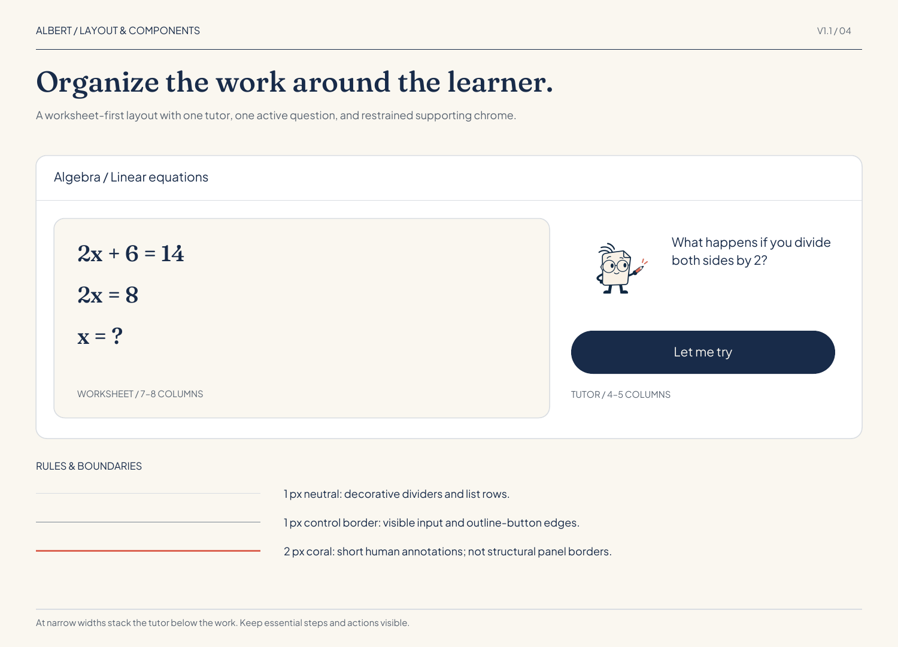

#### The page stack

Use this order: **application header → page-header group → main task region → related supporting material**. A footer is optional. Within each region, put the title or context first, then the evidence or work, then the relevant controls. Keep the primary question close to the symbol or step it describes.

#### Component anatomy

A typical bounded component uses **24 px desktop padding / 16 px mobile padding**, **12 px corner radius**, and an optional 1 px neutral border. Its internal order is: heading, supporting context if needed, main content, then action group. Use **16 px** between these parts. Do not nest a filled card inside another filled card unless the inner element is a distinct interactive field.

Use Paper as the dominant page surface and White only where a quiet surface distinction helps. Avoid adding shadows to every panel. A list should generally use aligned rows and thin separators instead of a stack of independent cards. A form keeps labels and messages next to their fields, with **8 px label-to-field spacing** and **24 px between field groups**. Inputs are at least **48 px high**, with **16 px horizontal padding** and a **12 px radius**.

#### Worksheet and tutor

Give the work area roughly **7–8 desktop columns** and the tutor **4–5 columns**, depending on the actual task. Keep a **24 px gutter**. The tutor holds one mascot, one current question or explanation, and a concise action group. A focused white/Paper panel may bound the worksheet; handwriting and annotations remain the central evidence.

Below tablet widths, stack the tutor below the relevant work or open it deliberately in a bottom panel. Do not cover live strokes or important symbols. Preserve the question text if the mascot is hidden. Use larger gaps to separate a new mathematical idea, not a proliferation of decorative panels.

### 7. Title slides and presentation templates

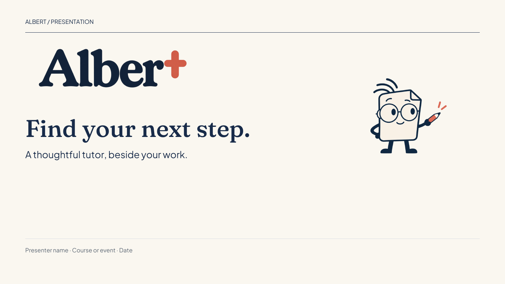

Files: [editable PowerPoint](templates/albert-presentation.pptx) · [three-page PDF](templates/PRESENTATION_TEMPLATES.pdf).

The templates use **16:9**, sized **13⅓ × 7½ inches** in PowerPoint and **960 × 540 pt** in the PDF reference. Text and basic shapes are editable in PowerPoint; the wordmark, icon, and mascot remain embedded PNGs. Fraunces and Plus Jakarta Sans must be installed for an exact PowerPoint text match. The PDF embeds its fonts and provides the visual reference.

#### Title slide

- **48 pt safe margin** on left and right; keep the top masthead and bottom metadata aligned to it.
- Small 11 pt masthead at the upper left, then a 0.5–0.75 pt Ink rule.
- Approved wordmark above the main title, with enough clearspace; never type the logo manually.
- One short **46/56 pt Fraunces** title, usually a maximum of two lines.
- One **18/26 pt** UI subtitle, ideally one line or two short lines.
- One supporting mascot at the right, separated from the title. Keep the title column under approximately two-thirds of the slide width.
- A footer rule and **11 pt** presenter/event/date line. Do not add a primary CTA button unless the slide is an interactive interface.

#### Section-divider slide

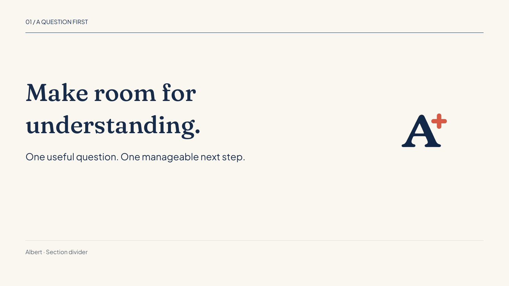

Use a section number and topic in the masthead, one **46 pt** title, one optional **18 pt** supporting sentence, and the A+ icon as a restrained side accent. Keep the same outer margins and footer position. This slide introduces an idea; it should not contain a paragraph or an image gallery.

#### Content slide

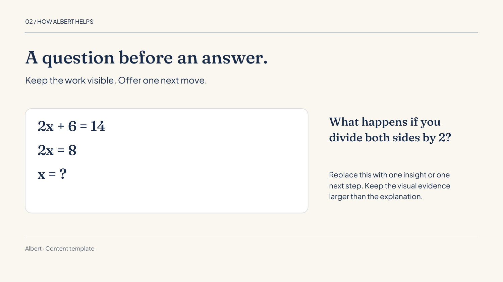

Use a **34/42 pt** Fraunces title, a short **17/25 pt** lead if needed, and a simple two-column content region. Give the visual evidence approximately **60%** of the usable width and the explanation **30%**, leaving the remainder as the gutter. A diagram, worksheet, or screenshot should be readable without zooming. Use one main insight and at most three supporting points. General presentation body copy should be at least **18 pt** where possible; the template's smaller 14 pt note is a replaceable secondary caption, not a model for dense body slides.

#### Things that stay aligned

Across slides, preserve the masthead baseline, rule endpoints, title left edge, main content edges, and footer baseline. Change content, not the grid. Use Coral for a focused annotation or the logo; keep paragraph text in Ink. Avoid decorative charts or invented metrics to fill space.

### 8. Applying the system

The supplementary stylesheet [albert.components.css](tokens/albert.components.css) implements these foundational classes. It uses [albert.css](tokens/albert.css) variables, plus the v1.1 layout/control tokens. It contains no JavaScript and is not a working menu, modal, or tutoring interface. Load fonts through the application's normal setup.

```html
<main class="albert-page albert-stack">
  <header class="albert-page-heading">
    <p class="albert-eyebrow">Algebra / Practice</p>
    <h1>Find the next step.</h1>
    <p>Work through the equation using your course methods.</p>
  </header>

  <section class="albert-panel albert-stack" aria-label="Tutor guidance">
    <p>What happens if you divide both sides by 2?</p>
    <div class="albert-actions">
      <button class="albert-button albert-button--primary" type="button">Let me try</button>
      <button class="albert-button albert-button--secondary" type="button">Show one step</button>
    </div>
  </section>
</main>
```

When adding a new component, specify its spacing, typography, states, focus behavior, and mobile reflow using this same system. Check it with real text, a long label, keyboard focus, and a narrow viewport before treating it as production-ready.


## 15. Complete website system

The [execution plan](WEBSITE_SYSTEMS_PLAN.md) records the audit and priorities. This section is also available as [WEBSITE_SYSTEMS.md](WEBSITE_SYSTEMS.md), with a [local interactive reference](reference/index.html), [component catalog](COMPONENT_CATALOG.md), [visual guide](WEBSITE_SYSTEMS.pdf), and [release checklist](PRODUCTION_CHECKLIST.md).

### 1. The layers of a website

| Layer | Elements | Albert's purpose |
|---|---|---|
| Identity | Name, logo, mascot, imagery, voice | A recognizable and trustworthy tutor |
| Foundations | Color roles, type, spacing, grids, corners, motion, layers | Consistent decisions across screens |
| Navigation | Header, sidebar, menu, breadcrumbs, tabs, footer | Help the learner locate and resume work |
| Input | Fields, selections, preferences, upload, validation | Gather accurate course and worksheet context |
| Content and data | Cards, lists, tables, badges, search, filters, progress | Find the right material and understand evidence |
| Feedback | Loading, empty, error, warning, success, notifications | Make system state and the next action clear |
| Layers and disclosure | Dialogs, expandable detail, optional help | Resolve focused decisions without overwhelming the page |
| Complete experiences | Landing, onboarding, course hub, workspace, progress, settings | Turn individual components into useful flows |
| Infrastructure | Authentication, permissions, storage, integrations, routing | Make the actual product operate reliably |
| Quality and maintenance | Accessibility, performance, SEO, analytics, tests, governance | Keep the experience useful as it grows |

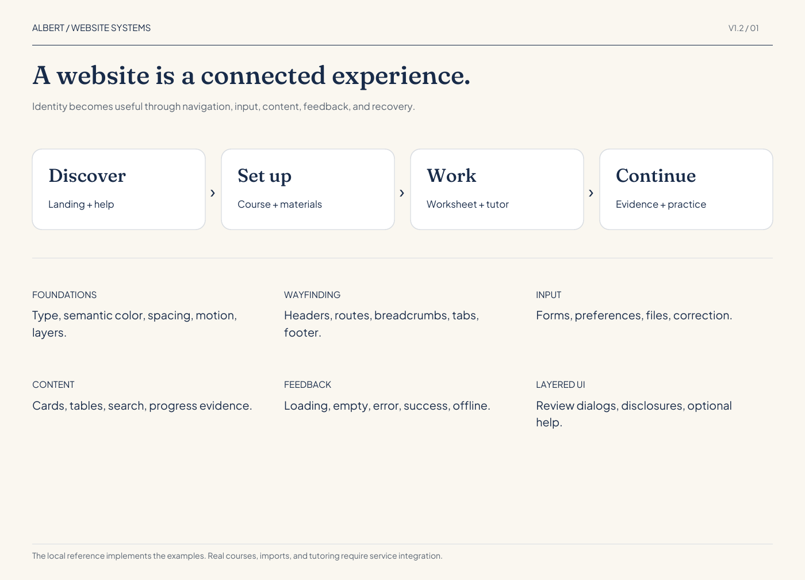

### 2. Foundations beyond appearance

#### Semantic color roles

New code should choose a role before a literal color. `action` maps to Ink, `action-on` to Paper, `surface` to Paper, `surface-raised` to White, `text` to Ink, and `text-secondary` to Muted. `success-surface` maps to Sage with Ink text. `danger-text` maps to the accessible dark coral. Information, pending, and error surfaces are quiet supporting tints, not additional primary brand colors.

Use a message or symbol with each status. A green background cannot explain success; a coral ring cannot identify the reason for an error. Preserve meaningful contrast for text, fields, focus outlines, and data marks. The contrast table in the master system still governs color pairing.

#### Layers and motion

Content stays in normal document flow. Sticky application chrome uses layer 20; optional dropdown surfaces use 30; custom non-native overlays reserve 40; toasts use 50. Native modal dialogs use the browser's top layer and do not need an arbitrary huge z-index. Avoid sticky content that covers a focused field or worksheet symbol.

Use the existing 180 ms transition token for small state changes. Animate neither the whole page nor every mascot appearance. Respect `prefers-reduced-motion`; a user's in-page preference can further reduce motion. Essential instructions stay readable without animation.

#### Icons and imagery

Use one consistent line-icon family, typically 18–20 px with 1.5–2 px strokes. Keep a text label for unfamiliar actions and an accessible name for icon-only controls. Icons do not replace mathematical notation. Use the mascot when a tutoring event benefits from its presence; do not decorate every list row with it. Provide image dimensions to reserve layout space and informative alt text only when the image adds information.

### 3. Information architecture and navigation

#### Recommended application routes

```text
Public
  /                 Product introduction and first action
  /help             Getting started and common questions
  /accessibility    Accessibility information and contact route
  /privacy          Actual product privacy information
  /terms            Actual applicable terms

Learner application
  /courses                         Course hub and resume points
  /courses/new                     Course setup and materials
  /courses/:courseId               Course overview
  /courses/:courseId/materials     Notes and worksheets
  /practice/:worksheetId           Writing workspace and tutor
  /progress                       Skill evidence and practice plan
  /settings                       Preferences and account controls
```

These routes define the product architecture; the catalog's links are local design-reference sections. Route names can adapt to the actual application router. Deep links should restore the same course or worksheet context, subject to authorization.

#### Navigation contracts

- **Main links:** use real anchors with meaningful destinations; retain browser open-in-new-tab behavior.
- **Current location:** mark the relevant destination with `aria-current="page"` or `location` as appropriate. Do not show all links as selected.
- **Breadcrumbs:** use an ordered list in a labeled nav; ancestor items are links, the current item is plain text. They show hierarchy rather than a second independent menu.
- **Tabs:** switch related views in the same context. Use `tablist`, `tab`, and `tabpanel`; one selected tab; roving tab order; Left/Right, Home, and End behavior.
- **Mobile navigation:** expose a real toggle with `aria-expanded` and `aria-controls`. Hidden links must leave the keyboard order. Preserve a useful focus destination after navigation.
- **Footer:** provide help, accessibility, and applicable policy destinations. Use real policy content and working routes before release.

Do not use a tab for a different website route unless it is implemented as actual navigation with appropriate browser behavior. Do not use a button solely to navigate to a normal page.

### 4. Forms, preferences, and materials

#### Field anatomy

Use a persistent label, field, concise helper text when needed, and an adjacent error. A placeholder is an optional example, not the only label. Inputs follow the existing 48 px minimum height and 12 px corner radius. Fieldsets with legends group related radios or checkboxes. Prefer native select and file controls until a genuinely required interaction warrants a custom widget.

Choose the input type and autocomplete appropriate to its meaning. State required or optional clearly. Validate on submission; revalidate corrected fields without demanding perfection on every keystroke. Preserve entered values after an error. A failed submit should show an error summary with links to invalid fields, focus that summary, set `aria-invalid`, and connect help/error text with `aria-describedby`.

#### Submission behavior

During a real asynchronous submit, keep the label recognizable, prevent duplicate requests when necessary, and expose real status. Do not mark a course as saved before the service confirms it. A server-side validation failure should produce the same field treatment as local validation. A network failure leaves the form intact and offers retry. Success names what changed and supplies the next action.

#### File and course import

The reference validates PDF/PNG/JPEG selection and a 10 MB local example limit. Production limits must match the real service; the server independently validates file size and content. Accepting a filename extension in the browser is a usability check, not file security or successful upload.

The actual import flow needs: choose source → select material → upload/authorize → processing → review extracted course context → confirm readiness. Distinguish queued, uploading, processing, ready, partially imported, cancelled, and failed states. Offer file-specific errors and retry. Do not turn an arbitrary animation into a progress percentage. Ask the learner to confirm uncertain notation or course context.

#### Account and preference patterns

Use clearly named preferences, explicit on/off labels for switches, and persistence feedback only after storage succeeds. Account entry and recovery should identify what action will happen, show useful errors, and preserve a return destination. The catalog has no real authentication and does not collect or send credentials. Production authentication should use the application's chosen identity service and accessible account-recovery flow.

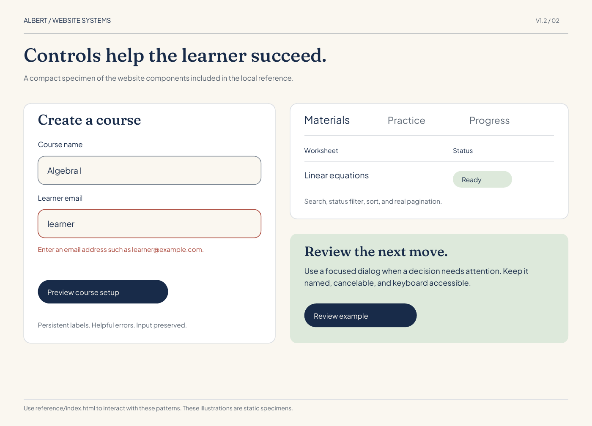

### 5. Content and data

#### Cards, lists, and tables

Use a card when an item combines a title, related metadata, status, and one main action. Use a list when items are simple and repeated; align rows instead of surrounding every value with its own box. Use a table for comparison across consistent columns. Give each table a caption or accessible name, header cells with scope, readable row spacing, and a deliberate horizontal-scroll region when narrow layouts cannot preserve comparison.

#### Finding material

Search matches the relevant title and context. Filters have visible labels and a clear-reset action. Sorting updates the table header's `aria-sort` and retains the active search/filter. Pagination uses real counts, clamps the current page when filtering changes the result set, and disables unavailable previous/next actions. Announce the resulting count politely without moving focus on every keystroke. Debounce server searches and handle out-of-order results in the actual product.

The reference implements these behaviors over six labeled example rows. Empty results are different from an empty account: “No worksheets match” offers broader search or filter reset; “Your first worksheet starts here” offers adding material.

#### Skills and progress

Show evidence, not invented precision. A skill summary should identify the skill, the work that supports the assessment, when that evidence was collected, and a proposed next practice step. Avoid fabricated percentages, unearned mastery badges, or interpreting time on a page as understanding. When a chart is useful, label units, provide a text summary, and preserve meaning without color alone. The package specifies this contract; it does not generate real learner assessments.

### 6. Feedback and asynchronous state matrix

| State | What to show | Next action | Mascot |
|---|---|---|---|
| Initial empty | Explain the missing content and first useful action | Add materials or start a worksheet | Welcoming |
| Loading | Stable geometry, meaningful status, optional decorative skeleton | Wait or cancel when supported | Thinking only for actual tutor processing |
| Ready | Actual content and available actions | Continue the task | Waiting or none |
| Success | Name the confirmed change or demonstrated skill | Continue | Celebrating only when learning progress is confirmed |
| No search results | Explain the filter/query outcome | Clear filters or broaden search | Usually none |
| Validation error | Summary plus specific field-level messages | Correct the linked field | Usually none |
| Processing failure | Describe what could not finish, preserve work | Retry or choose another source | Encouraging |
| Offline or disconnected | Honest connection status and save state | Retry after reconnecting | Waiting |
| Unauthorized/session expired | Clear explanation without exposing protected data | Sign in or request appropriate access | Usually none |
| Missing page | Contextual recovery, no blame | Return to courses or browse materials | Encouraging |

Use **inline messages** for local problems, **banners** for page-wide conditions, **toasts** for nonblocking confirmations, and **dialogs** for focused decisions. Important information must remain available long enough to read. The catalog's toast stays until dismissed. Loading and progress controls are explicitly manual specimens, not fake network activity.

Never imply that unsaved work is safe. “Saved” means an acknowledged write; “Saving…” means an in-flight operation; “Changes not saved” describes a failure and its recovery path. Offline support requires actual storage and synchronization behavior, not only a banner.

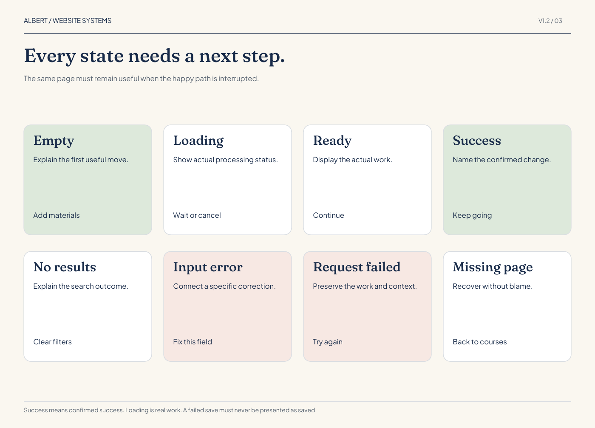

### 7. Dialogs, menus, and progressive disclosure

Use native `<dialog>` for focused review and confirmation. Give it an accessible title and description, choose the initial focus deliberately, keep keyboard focus in the modal, allow Escape for cancelable actions, and return focus to the invoking control when it closes. A destructive decision must name the affected item and consequences; use explicit verbs and a cancel path. Do not use a dialog for a routine success message.

Use native `<details>` for supplementary explanations. Keep instructions required to finish the task visible. A small help disclosure is often more accessible on touch devices than a hover-only tooltip. If implementing a true tooltip later, it must appear on focus as well as hover, dismiss with Escape, stay available while hovered, and contain no essential instruction that has no other representation.

For a navigation dropdown, a disclosure button and ordinary links are usually sufficient. Use an ARIA menu only when implementing the full corresponding menu keyboard pattern. Do not add menu roles to an ordinary site navigation list merely to change its appearance.

### 8. Complete-page patterns

| Page | Necessary regions | Primary action | Required non-happy states |
|---|---|---|---|
| Landing | Header, clear promise, worksheet/tutor demonstration, concrete benefits, first action, footer | Start with your course | Missing media, narrow viewport, reduced motion |
| Course hub | Page title, resume point, course list, search, add-course action | Resume or add a course | First use, filtered empty, loading, fetch error |
| Course setup | Stepper, current form, material source, review, readiness | Continue setup | Field errors, upload errors, cancelled import |
| Course overview | Course context, materials/practice/progress views, recent work | Open a worksheet | Missing material, partial import, revoked source access |
| Workspace | Writing tools, worksheet, precise annotations, tutor, step controls, save status | Work independently or ask a hint | Ambiguous handwriting, hint failure, unsaved work, reconnect |
| Progress | Skills, evidence, explanations, recommended practice | Practice a skill | Insufficient evidence, stale data, unavailable assessment |
| Settings | Account, preferences, accessibility, data controls | Save a preference | Save failure, session expiry, destructive confirmation |
| Help/policy | Clear title, navigable content, contact or applicable policy details | Find an answer/contact route | Missing content and broken destinations |
| Error/404 | Specific explanation, recovery destination | Return to a useful place | Unavailable destination or repeated error |

#### Onboarding

Use a short three-step structure: **Course → Materials → Ready**. Identify the current step with text and `aria-current="step"`. Back preserves information. Continue validates the current step. Do not require irrelevant profile details before a learner can begin useful work. On reload or resuming a real setup, restore its actual saved state.

#### Worksheet teaching pattern

The example progresses from a question to one worked operation, with a deliberate “Let me try” action returning Albert to waiting. The actual application supplies handwriting, course retrieval, model responses, stroke-aware annotations, and persistent progress. The surrounding design should keep the work visible and the learner in control. Never expose a generated answer simply because a loading animation finished.

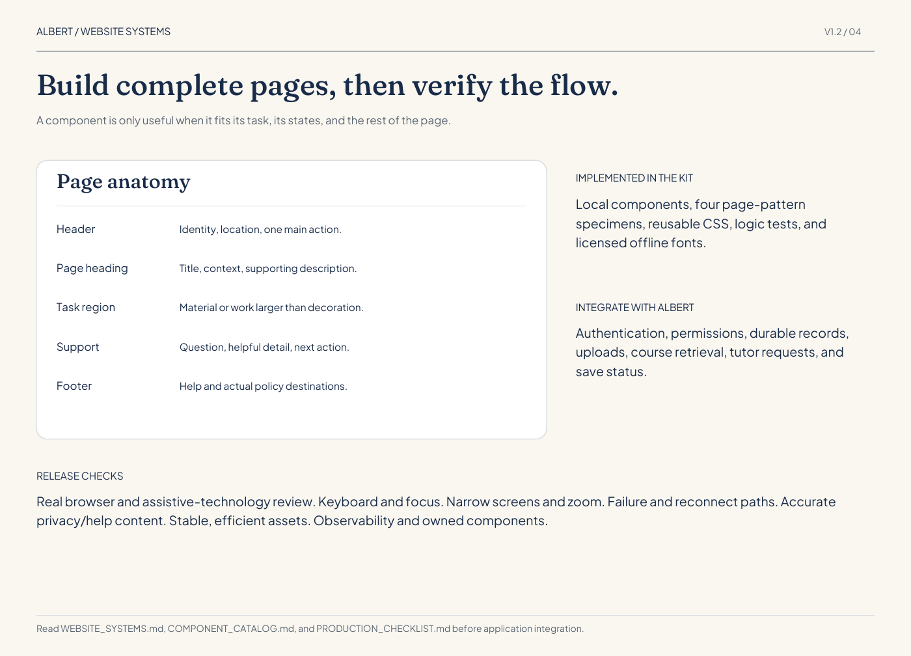

### 9. Responsive and accessible behavior

Preserve the existing 12/8/4-column layout rules, but choose component reflow by content. A dense filter bar can wrap before the site-wide breakpoint. A dialog is width constrained and internally scrollable if its content exceeds the viewport. A table may scroll inside its labeled region; a page should not acquire accidental horizontal scrolling.

Every page needs semantic header/nav/main/footer regions where appropriate, a working skip link, meaningful headings, visible keyboard focus, persistent labels, and text alternatives for essential visuals. Focus must remain useful after opening, closing, replacing, or removing UI. Use polite live regions for meaningful updates and errors carefully; avoid multiple competing announcements. Reserve urgent alerts for events that need interruption.

Support a 320 px layout, zoom/reflow checks, text expansion, keyboard-only use, and reduced motion. Respect browser autofill, password managers, native selection, and normal navigation behavior. Accessibility needs verification in the integrated product with a screen reader and real browser; markup alone is not a certification.

#### Content flexibility

Keep copy in a replaceable content layer. Allow longer translated labels and multi-line buttons rather than clipping them. Format dates, times, and numbers according to the learner's locale. Course mathematics and language may require different notation and directionality; confirm behavior before offering an RTL locale. Never encode a critical instruction only in an image.

### 10. What makes it a production website

| Concern | Required product work |
|---|---|
| Routing | Real destinations, deep links, reload behavior, useful 404 handling |
| Authentication | Actual identity provider, session states, account recovery, return paths |
| Authorization | Course and material access checked by the service on every protected request |
| Storage | Persistent courses, worksheets, annotations, preferences, and progress |
| Upload/import | Server-side file checks, storage, processing, errors, cancellation, source access |
| Tutor integration | Course context, real processing status, uncertainty handling, scoped responses |
| Privacy and policy content | Accurate explanations of actual collection, use, retention, and user controls |
| Performance | Optimized image derivatives, deferred noncritical UI, bounded fonts, stable layout |
| SEO and sharing | Useful public titles/descriptions, canonical URLs, sharing metadata; private data kept out of public indexing |
| Observability | Useful failure signals, import diagnostics, and service timing without logging sensitive student work unnecessarily |
| Analytics | Only events needed to understand use; actual consent/preferences honored where applicable |
| Content maintenance | Owned help/policy content and checked navigation destinations |

These concerns belong in the system because they change the visible experience. They are integration requirements, not completed services in the local reference. There is no need to add payments, a pricing page, or social features unless Albert's product actually needs them.

### 11. Component contracts and governance

Each reusable component should record purpose, anatomy, variants, sizes, states, keyboard behavior, content rules, responsive behavior, and its actual implementation status. Use the [catalog](COMPONENT_CATALOG.md) to distinguish an implemented example from a specified future integration.

Keep token names stable. Prefer semantic roles over adding a literal color to every new component. Record changes in the changelog, retain the chosen logo/mascot masters, and review new components against a real Albert task. A component is ready for application integration only after its important states and keyboard behavior have been checked. Use the [production checklist](PRODUCTION_CHECKLIST.md) for release acceptance.

### 12. Using the implementation

Open [reference/index.html](reference/index.html) from the extracted folder in a current browser. It uses local CSS, JavaScript, images, and licensed fonts and makes no API calls. Keep the folder structure intact. Its sample form, files, and table data are not persisted. It can also be served by an application's usual static development workflow.

For reusable styling, load the stylesheets in this order:

```html
<link rel="stylesheet" href="tokens/albert.fonts.css">
<link rel="stylesheet" href="tokens/albert.css">
<link rel="stylesheet" href="tokens/albert.components.css">
<link rel="stylesheet" href="tokens/albert.web.css">
```

The optional font stylesheet uses bundled OFL-licensed Fraunces and Plus Jakarta Sans files. The pure helpers in [reference/logic.js](reference/logic.js) demonstrate search, filter, sort, pagination, validation, and local file checks; [reference/app.js](reference/app.js) connects the specimens. The catalog stylesheet includes page-specific presentation, not a requirement to copy its documentation sidebar into Albert's product.

Run the included helper tests with:

```sh
node --test tests/logic.test.cjs
```

See [VERIFICATION.md](VERIFICATION.md) for the checks actually performed and the remaining browser review.


## 16. Production assets and screen handoff

This section is also provided as [PRODUCTION_ASSETS.md](PRODUCTION_ASSETS.md). See [ASSET_REVIEW.pdf](ASSET_REVIEW.pdf) for the logo and aligned-mascot review pages.

### 1. Editable vector logos

Folder: [assets/logos/vector](assets/logos/vector/vector-manifest.json).

| Master | Primary SVG | Other formats and variants |
|---|---|---|
| Scholar wordmark | [albert-wordmark-primary.svg](assets/logos/vector/albert-wordmark-primary.svg) | Primary, mono Ink, reverse Paper/Coral, and mono Paper; matching PNG and PDF |
| Serif A+ | [albert-icon-primary.svg](assets/logos/vector/albert-icon-primary.svg) | The same four variants; matching PNG and PDF |
| Compact A+ | [albert-icon-small.svg](assets/logos/vector/albert-icon-small.svg) | A slightly stronger plus for small browser/app exports |

The SVGs contain editable cubic paths and simple strokes, with **no embedded raster image and no font dependency**. The wordmark is a two-color path reconstruction of the chosen raster silhouette, preserving the raised, shortened coral t/plus. The icon takes its serif A directly from that Scholar lettering for a consistent final master. The plus is a clean, balanced rounded construction.

These are production reconstructions of the approved concept, not original layered drawing files. The earlier standalone PNGs remain as source references. The vector masters use exact Ink/Paper/Coral values and remove the raster's incidental shading. Use these SVG masters for new web, print, and scaling work. Their groups identify the lettering and plus so a designer can edit them independently.

Reverse assets are designed for Ink backgrounds. Mono Paper also needs a dark surface. Apply the clearspace rules from the master document in addition to any transparent canvas margin. The vector manifest records the source hash, variant, and path count.

### 2. Website, app, and sharing exports

Folder: `assets/icons/`.

| Export | Purpose |
|---|---|
| [favicon.svg](assets/icons/favicon.svg) | Scalable browser identity |
| [favicon.ico](assets/icons/favicon.ico) | Embedded 16, 32, and 48 px compatibility images |
| [favicon-16.png](assets/icons/favicon-16.png), [32](assets/icons/favicon-32.png), [48](assets/icons/favicon-48.png) | Exact small raster exports |
| [apple-touch-icon.png](assets/icons/apple-touch-icon.png) | 180 × 180 px home-screen icon |
| [icon-192.png](assets/icons/icon-192.png), [icon-512.png](assets/icons/icon-512.png) | Standard app icons |
| [maskable 192](assets/icons/icon-maskable-192.png), [maskable 512](assets/icons/icon-maskable-512.png) | Additional safe-area padding for platform masks |
| [site.webmanifest](assets/icons/site.webmanifest) | Example app-identity manifest with the supplied icon paths |

The exports use a Paper background and a strengthened small-size A+. Maskable files reserve additional padding; let the platform apply its shape instead of baking a rounded mask into the source. Review favicons at actual size, not only enlarged.

```html
<link rel="icon" href="/assets/icons/favicon.svg" type="image/svg+xml">
<link rel="alternate icon" href="/assets/icons/favicon.ico">
<link rel="apple-touch-icon" href="/assets/icons/apple-touch-icon.png">
<link rel="manifest" href="/assets/icons/site.webmanifest">
<meta name="theme-color" content="#182B49">
```

Adjust paths, manifest ID, scope, and start URL to the actual deployment. A manifest alone does not implement offline support, installation eligibility, or a service worker.

#### Social sharing


- [Wide card, 1200 × 630](assets/social/albert-og-1200x630.png)
- [Square card, 1080 × 1080](assets/social/albert-square-1080.png)
- [Print/layout masters PDF](assets/social/albert-social-masters.pdf)
- [Metadata and alt text](assets/social/social-metadata.json)

Use the wide card for Open Graph and large-card sharing. Production metadata needs absolute public image URLs, an actual canonical page URL, and the correct title/description. Do not put private learner names, course work, or account data in public sharing metadata.

### 3. Aligned mascot library and motion

Folder: `assets/mascot/normalized/`.

All eight poses are exported at **128, 256, 512, and 1024 px square**. Every size uses the same paper-body scale, horizontal paper center, and standing-foot baseline. The 1024 px master uses a 460 px paper-body height and 924 px baseline; smaller sizes scale those measurements proportionally. The pose-specific drawing remains intact.

Use these exports to swap poses in a fixed-size slot. The original pose PNGs remain available for provenance. A celebratory lifted foot remains lifted; the grounded foot establishes the baseline. Natural drawing differences remain, so these files are not a rigged frame-by-frame animation source.

| Pose | 512 px production export |
|---|---|
| Thinking | [albert-thinking.png](assets/mascot/normalized/512/albert-thinking.png) |
| Guiding | [albert-guiding.png](assets/mascot/normalized/512/albert-guiding.png) |
| Celebrating | [albert-celebrating.png](assets/mascot/normalized/512/albert-celebrating.png) |
| Welcoming | [albert-welcoming.png](assets/mascot/normalized/512/albert-welcoming.png) |
| Listening | [albert-listening.png](assets/mascot/normalized/512/albert-listening.png) |
| Encouraging | [albert-encouraging.png](assets/mascot/normalized/512/albert-encouraging.png) |
| Explaining | [albert-explaining.png](assets/mascot/normalized/512/albert-explaining.png) |
| Waiting | [albert-waiting.png](assets/mascot/normalized/512/albert-waiting.png) |

Additional files: [alignment metadata](assets/mascot/normalized/alignment.json), [eight-cell sprite sheet](assets/mascot/normalized/pose-sheet-512.png), [motion metadata](assets/mascot/motion/motion.json), and a [one-shot guiding → waiting WebP](assets/mascot/motion/guiding-to-waiting.webp).

The transition has six frames, totals 180 ms, and plays once. It crossfades aligned drawings; it is not a skeletal animation. The [motion preview](assets/mascot/motion/preview.html) is user-triggered and chooses the static waiting pose when reduced motion is requested. Product code should follow the same rule and avoid repeated idle animation.

### 4. Responsive screen masters

Sources are editable HTML/CSS/JavaScript in `templates/screens/`. Each page has a desktop and mobile reference capture in `templates/screens/exports/`.

| Screen | Editable source | Captures |
|---|---|---|
| Course dashboard | [dashboard.html](templates/screens/dashboard.html) | [Desktop](templates/screens/exports/dashboard-desktop.png) · [Mobile](templates/screens/exports/dashboard-mobile.png) |
| Course onboarding | [onboarding.html](templates/screens/onboarding.html) | [Desktop](templates/screens/exports/onboarding-desktop.png) · [Mobile](templates/screens/exports/onboarding-mobile.png) |
| Worksheet/tutor | [worksheet.html](templates/screens/worksheet.html) | [Desktop](templates/screens/exports/worksheet-desktop.png) · [Mobile](templates/screens/exports/worksheet-mobile.png) |
| Preferences | [settings.html](templates/screens/settings.html) | [Desktop](templates/screens/exports/settings-desktop.png) · [Mobile](templates/screens/exports/settings-mobile.png) |

The shared [screen.css](templates/screens/screen.css) and [screen.js](templates/screens/screen.js) preserve the established brand, typography, and 44 px minimum controls. Desktop uses a sidebar and a generous work region; mobile collapses navigation and stacks the tutor below the worksheet. Sources are implementation-editable masters, not Figma files.

The examples include illustrative course data and limited local interactions. Onboarding advances through course/material/review steps; the worksheet shows a question and one worked operation; preferences confirm only a local preview. These screens do not implement real authentication, durable course setup, handwriting, upload processing, or account storage.

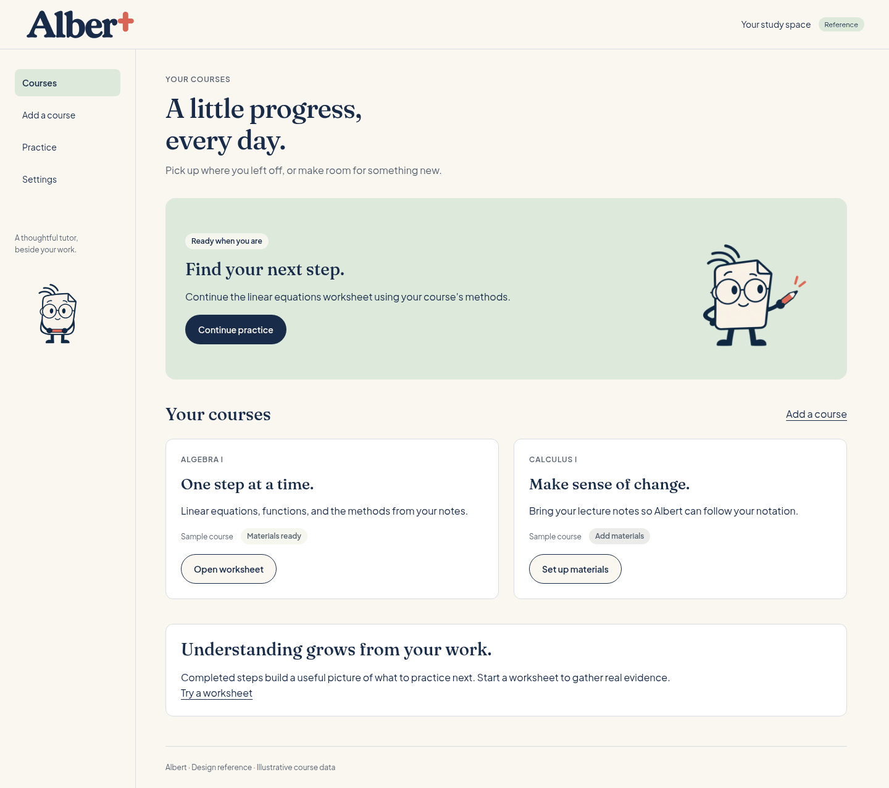

### 5. Communication templates

Folder: `templates/emails/`. Each template has an HTML and a plain-text version, plus a rendered local preview.

| Template | HTML | Plain text | Local preview |
|---|---|---|---|
| Welcome | [welcome.html](templates/emails/welcome.html) | [welcome.txt](templates/emails/welcome.txt) | [preview](templates/emails/previews/welcome.html) |
| Account recovery | [account-recovery.html](templates/emails/account-recovery.html) | [account-recovery.txt](templates/emails/account-recovery.txt) | [preview](templates/emails/previews/account-recovery.html) |
| Import complete | [import-complete.html](templates/emails/import-complete.html) | [import-complete.txt](templates/emails/import-complete.txt) | [preview](templates/emails/previews/import-complete.html) |
| Support response | [support-response.html](templates/emails/support-response.html) | [support-response.txt](templates/emails/support-response.txt) | [preview](templates/emails/previews/support-response.html) |

The HTML uses a fluid 600 px table layout, inline styles, email-safe fallback fonts, and a PNG wordmark. The [manifest](templates/emails/template-manifest.json) lists copy, action variables, and sample values. Previews use example.invalid destinations; nothing is sent.

Server rendering must escape text, use real absolute asset/action URLs, fill the actual sender/support details, and enforce any recovery-token expiration through the identity service. Counts and import status must come from actual processing results. Test the final templates in the actual email clients used by the product; Chromium previews are not Outlook/Gmail compatibility tests.

### 6. QA materials

The `qa/` folder contains a machine-readable browser report, visual baseline captures, email preview screenshots, and the capture scope. The browser suite exercises keyboard tabs, error-summary focus, local form/file validation, filtering/pagination, modal focus, Escape, focus return, disclosure, onboarding, hint progression, responsive overflow, and reduced motion.

Accessibility scans use axe-core's WCAG A/AA rules in Chromium fixtures. A passing scan does not replace a real screen-reader review. The managed preview relay was unavailable; the tests use self-contained fixtures assembled from the exact packaged HTML/CSS/JS/assets. Routing, API behavior, and deployed browser policy are outside that fixture scope.

Visual captures are **reference baselines for review**, not a claim that the user has already approved every new screen. The supplied visual comparison check detects rendering changes and should update baselines only after deliberate review. Record the browser version and platform when changing baselines.

See [VERIFICATION.md](VERIFICATION.md), [the browser report](qa/browser-report.json), and [PRODUCTION_CHECKLIST.md](PRODUCTION_CHECKLIST.md) for the actual completed checks and remaining real-client reviews.
