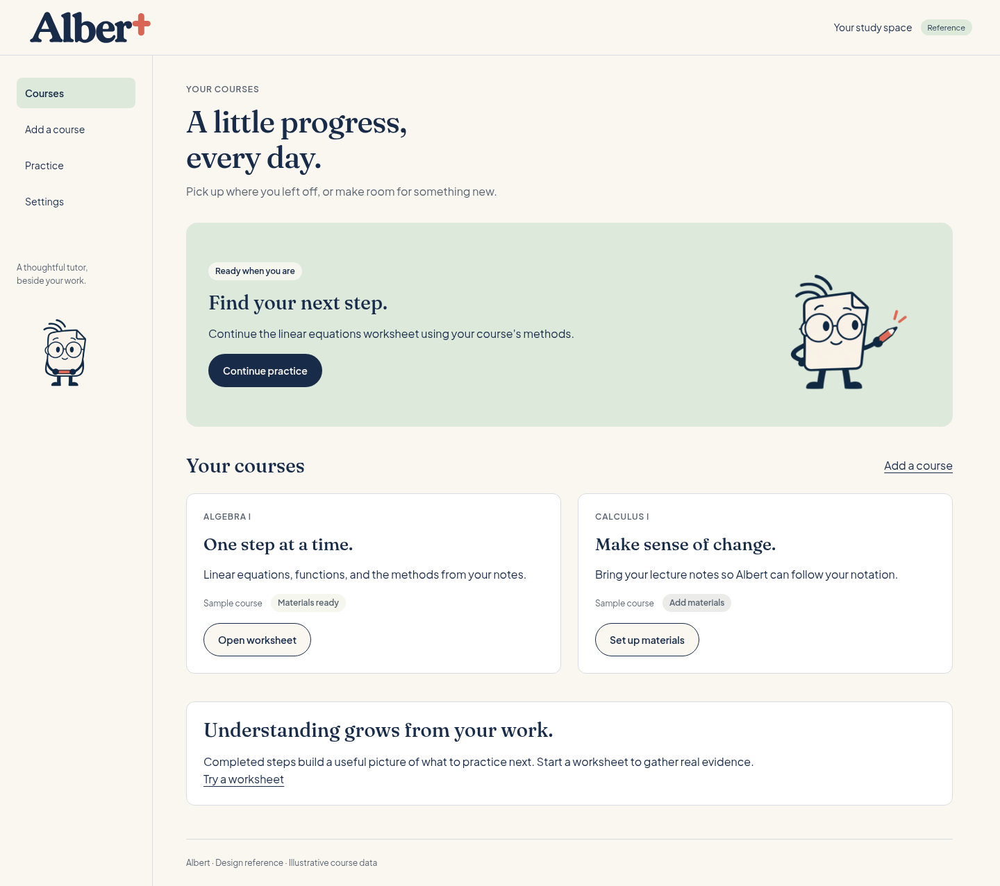

# Albert — Production Assets and Screen Handoff

**Version 1.3.0 · November 15, 2026**

This release adds the six production-handoff sets: editable vector logos, website/app/social exports, aligned mascot files and a transition, responsive screen masters, communication templates, and browser/visual QA materials.

## 1. Editable vector logos

Folder: [assets/logos/vector](assets/logos/vector/vector-manifest.json).

| Master | Primary SVG | Other formats and variants |
|---|---|---|
| Scholar wordmark | [albert-wordmark-primary.svg](assets/logos/vector/albert-wordmark-primary.svg) | Primary, mono Ink, reverse Paper/Coral, and mono Paper; matching PNG and PDF |
| Serif A+ | [albert-icon-primary.svg](assets/logos/vector/albert-icon-primary.svg) | The same four variants; matching PNG and PDF |
| Compact A+ | [albert-icon-small.svg](assets/logos/vector/albert-icon-small.svg) | A slightly stronger plus for small browser/app exports |

The SVGs contain editable cubic paths and simple strokes, with **no embedded raster image and no font dependency**. The wordmark is a two-color path reconstruction of the chosen raster silhouette, preserving the raised, shortened coral t/plus. The icon takes its serif A directly from that Scholar lettering for a consistent final master. The plus is a clean, balanced rounded construction.

These are production reconstructions of the approved concept, not original layered drawing files. The earlier standalone PNGs remain as source references. The vector masters use exact Ink/Paper/Coral values and remove the raster's incidental shading. Use these SVG masters for new web, print, and scaling work. Their groups identify the lettering and plus so a designer can edit them independently.

Reverse assets are designed for Ink backgrounds. Mono Paper also needs a dark surface. Apply the clearspace rules from the master document in addition to any transparent canvas margin. The vector manifest records the source hash, variant, and path count.

## 2. Website, app, and sharing exports

Folder: `assets/icons/`.

| Export | Purpose |
|---|---|
| [favicon.svg](assets/icons/favicon.svg) | Scalable browser identity |
| [favicon.ico](assets/icons/favicon.ico) | Embedded 16, 32, and 48 px compatibility images |
| [favicon-16.png](assets/icons/favicon-16.png), [32](assets/icons/favicon-32.png), [48](assets/icons/favicon-48.png) | Exact small raster exports |
| [apple-touch-icon.png](assets/icons/apple-touch-icon.png) | 180 × 180 px home-screen icon |
| [icon-192.png](assets/icons/icon-192.png), [icon-512.png](assets/icons/icon-512.png) | Standard app icons |
| [maskable 192](assets/icons/icon-maskable-192.png), [maskable 512](assets/icons/icon-maskable-512.png) | Additional safe-area padding for platform masks |
| [site.webmanifest](assets/icons/site.webmanifest) | Example app-identity manifest with the supplied icon paths |

The exports use a Paper background and a strengthened small-size A+. Maskable files reserve additional padding; let the platform apply its shape instead of baking a rounded mask into the source. Review favicons at actual size, not only enlarged.

```html
<link rel="icon" href="/assets/icons/favicon.svg" type="image/svg+xml">
<link rel="alternate icon" href="/assets/icons/favicon.ico">
<link rel="apple-touch-icon" href="/assets/icons/apple-touch-icon.png">
<link rel="manifest" href="/assets/icons/site.webmanifest">
<meta name="theme-color" content="#182B49">
```

Adjust paths, manifest ID, scope, and start URL to the actual deployment. A manifest alone does not implement offline support, installation eligibility, or a service worker.

### Social sharing


- [Wide card, 1200 × 630](assets/social/albert-og-1200x630.png)
- [Square card, 1080 × 1080](assets/social/albert-square-1080.png)
- [Print/layout masters PDF](assets/social/albert-social-masters.pdf)
- [Metadata and alt text](assets/social/social-metadata.json)

Use the wide card for Open Graph and large-card sharing. Production metadata needs absolute public image URLs, an actual canonical page URL, and the correct title/description. Do not put private learner names, course work, or account data in public sharing metadata.

## 3. Aligned mascot library and motion

Folder: `assets/mascot/normalized/`.

All eight poses are exported at **128, 256, 512, and 1024 px square**. Every size uses the same paper-body scale, horizontal paper center, and standing-foot baseline. The 1024 px master uses a 460 px paper-body height and 924 px baseline; smaller sizes scale those measurements proportionally. The pose-specific drawing remains intact.

Use these exports to swap poses in a fixed-size slot. The original pose PNGs remain available for provenance. A celebratory lifted foot remains lifted; the grounded foot establishes the baseline. Natural drawing differences remain, so these files are not a rigged frame-by-frame animation source.

| Pose | 512 px production export |
|---|---|
| Thinking | [albert-thinking.png](assets/mascot/normalized/512/albert-thinking.png) |
| Guiding | [albert-guiding.png](assets/mascot/normalized/512/albert-guiding.png) |
| Celebrating | [albert-celebrating.png](assets/mascot/normalized/512/albert-celebrating.png) |
| Welcoming | [albert-welcoming.png](assets/mascot/normalized/512/albert-welcoming.png) |
| Listening | [albert-listening.png](assets/mascot/normalized/512/albert-listening.png) |
| Encouraging | [albert-encouraging.png](assets/mascot/normalized/512/albert-encouraging.png) |
| Explaining | [albert-explaining.png](assets/mascot/normalized/512/albert-explaining.png) |
| Waiting | [albert-waiting.png](assets/mascot/normalized/512/albert-waiting.png) |

Additional files: [alignment metadata](assets/mascot/normalized/alignment.json), [eight-cell sprite sheet](assets/mascot/normalized/pose-sheet-512.png), [motion metadata](assets/mascot/motion/motion.json), and a [one-shot guiding → waiting WebP](assets/mascot/motion/guiding-to-waiting.webp).

The transition has six frames, totals 180 ms, and plays once. It crossfades aligned drawings; it is not a skeletal animation. The [motion preview](assets/mascot/motion/preview.html) is user-triggered and chooses the static waiting pose when reduced motion is requested. Product code should follow the same rule and avoid repeated idle animation.

## 4. Responsive screen masters

Sources are editable HTML/CSS/JavaScript in `templates/screens/`. Each page has a desktop and mobile reference capture in `templates/screens/exports/`.

| Screen | Editable source | Captures |
|---|---|---|
| Course dashboard | [dashboard.html](templates/screens/dashboard.html) | [Desktop](templates/screens/exports/dashboard-desktop.png) · [Mobile](templates/screens/exports/dashboard-mobile.png) |
| Course onboarding | [onboarding.html](templates/screens/onboarding.html) | [Desktop](templates/screens/exports/onboarding-desktop.png) · [Mobile](templates/screens/exports/onboarding-mobile.png) |
| Worksheet/tutor | [worksheet.html](templates/screens/worksheet.html) | [Desktop](templates/screens/exports/worksheet-desktop.png) · [Mobile](templates/screens/exports/worksheet-mobile.png) |
| Preferences | [settings.html](templates/screens/settings.html) | [Desktop](templates/screens/exports/settings-desktop.png) · [Mobile](templates/screens/exports/settings-mobile.png) |

The shared [screen.css](templates/screens/screen.css) and [screen.js](templates/screens/screen.js) preserve the established brand, typography, and 44 px minimum controls. Desktop uses a sidebar and a generous work region; mobile collapses navigation and stacks the tutor below the worksheet. Sources are implementation-editable masters, not Figma files.

The examples include illustrative course data and limited local interactions. Onboarding advances through course/material/review steps; the worksheet shows a question and one worked operation; preferences confirm only a local preview. These screens do not implement real authentication, durable course setup, handwriting, upload processing, or account storage.



## 5. Communication templates

Folder: `templates/emails/`. Each template has an HTML and a plain-text version, plus a rendered local preview.

| Template | HTML | Plain text | Local preview |
|---|---|---|---|
| Welcome | [welcome.html](templates/emails/welcome.html) | [welcome.txt](templates/emails/welcome.txt) | [preview](templates/emails/previews/welcome.html) |
| Account recovery | [account-recovery.html](templates/emails/account-recovery.html) | [account-recovery.txt](templates/emails/account-recovery.txt) | [preview](templates/emails/previews/account-recovery.html) |
| Import complete | [import-complete.html](templates/emails/import-complete.html) | [import-complete.txt](templates/emails/import-complete.txt) | [preview](templates/emails/previews/import-complete.html) |
| Support response | [support-response.html](templates/emails/support-response.html) | [support-response.txt](templates/emails/support-response.txt) | [preview](templates/emails/previews/support-response.html) |

The HTML uses a fluid 600 px table layout, inline styles, email-safe fallback fonts, and a PNG wordmark. The [manifest](templates/emails/template-manifest.json) lists copy, action variables, and sample values. Previews use example.invalid destinations; nothing is sent.

Server rendering must escape text, use real absolute asset/action URLs, fill the actual sender/support details, and enforce any recovery-token expiration through the identity service. Counts and import status must come from actual processing results. Test the final templates in the actual email clients used by the product; Chromium previews are not Outlook/Gmail compatibility tests.

## 6. QA materials

The `qa/` folder contains a machine-readable browser report, visual baseline captures, email preview screenshots, and the capture scope. The browser suite exercises keyboard tabs, error-summary focus, local form/file validation, filtering/pagination, modal focus, Escape, focus return, disclosure, onboarding, hint progression, responsive overflow, and reduced motion.

Accessibility scans use axe-core's WCAG A/AA rules in Chromium fixtures. A passing scan does not replace a real screen-reader review. The managed preview relay was unavailable; the tests use self-contained fixtures assembled from the exact packaged HTML/CSS/JS/assets. Routing, API behavior, and deployed browser policy are outside that fixture scope.

Visual captures are **reference baselines for review**, not a claim that the user has already approved every new screen. The supplied visual comparison check detects rendering changes and should update baselines only after deliberate review. Record the browser version and platform when changing baselines.

See [VERIFICATION.md](VERIFICATION.md), [the browser report](qa/browser-report.json), and [PRODUCTION_CHECKLIST.md](PRODUCTION_CHECKLIST.md) for the actual completed checks and remaining real-client reviews.
