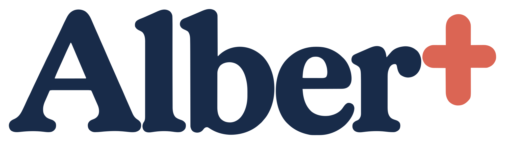

# Albert Brand Kit

**v1.3.0 · November 15, 2026**

**Open [the interactive website-system reference](reference/index.html)** for working local examples. Read [the website-system specification](WEBSITE_SYSTEMS.md) and [component catalog](COMPONENT_CATALOG.md) for the expanded system.

**New in v1.3:** [production asset index](PRODUCTION_ASSETS.md) · [logo/pose review PDF](ASSET_REVIEW.pdf) · [responsive screen review](templates/screens/SCREEN_MASTERS.pdf) · [QA evidence](qa/README.md).

Start with the [full-page brand identity](BRAND_IDENTITY.md), then use the [master design system](MASTER_DESIGN_SYSTEM.md) for design and implementation rules. The print version of the identity is [one PDF page](BRAND_IDENTITY.pdf).

## Documents

| File | Contents |
|---|---|
| [BRAND_IDENTITY.md](BRAND_IDENTITY.md) | Full-page brand narrative, signature, palette, type, mascot, and voice |
| [BRAND_IDENTITY.pdf](BRAND_IDENTITY.pdf) | One-page designed print companion |
| [MASTER_DESIGN_SYSTEM.md](MASTER_DESIGN_SYSTEM.md) | Brand rules, logos, colors, contrast, type, components, tutoring behavior, mascot states, and handoff |
| [MASCOT_POSES.pdf](MASCOT_POSES.pdf) | Contact sheet of all eight standalone exported poses |
| [LAYOUT_AND_COMPONENTS.md](LAYOUT_AND_COMPONENTS.md) | Detailed buttons, spacing, grids, dividers, headers, composition, and slide rules |
| [LAYOUT_AND_COMPONENTS.pdf](LAYOUT_AND_COMPONENTS.pdf) | Four illustrated specification pages |
| [Presentation PDF](templates/PRESENTATION_TEMPLATES.pdf) | Three 16:9 slide templates |
| [Editable PowerPoint](templates/albert-presentation.pptx) | Title, section divider, and content slides with editable text and basic shapes |
| [WEBSITE_SYSTEMS_PLAN.md](WEBSITE_SYSTEMS_PLAN.md) | Audit, priorities, and delivered expansion |
| [WEBSITE_SYSTEMS.md](WEBSITE_SYSTEMS.md) | Navigation, input, data, feedback, page patterns, accessibility, and integration |
| [WEBSITE_SYSTEMS.pdf](WEBSITE_SYSTEMS.pdf) | Four illustrated website-system pages |
| [COMPONENT_CATALOG.md](COMPONENT_CATALOG.md) | Component contracts and actual delivery status |
| [PRODUCTION_CHECKLIST.md](PRODUCTION_CHECKLIST.md) | Acceptance criteria for the real Albert application |
| [VERIFICATION.md](VERIFICATION.md) | Checks actually performed and remaining browser review |
| [PRODUCTION_ASSETS.md](PRODUCTION_ASSETS.md) | Vector logos, website/social exports, aligned poses, screens, emails, and QA |
| [ASSET_REVIEW.pdf](ASSET_REVIEW.pdf) | Production logo variants and aligned character review |
| [Screen review PDF](templates/screens/SCREEN_MASTERS.pdf) | Four desktop/mobile screen pairs |
| [QA reference pack](qa/README.md) | Browser report, visual baselines, and repeatable checks |
| [CHANGELOG.md](CHANGELOG.md) | Version history |

## Standalone logos

- [Scholar wordmark — editable SVG](assets/logos/vector/albert-wordmark-primary.svg) · [PNG](assets/logos/vector/albert-wordmark-primary.png)
- [Serif A+ icon — editable SVG](assets/logos/vector/albert-icon-primary.svg) · [PNG](assets/logos/vector/albert-icon-primary.png)

## Individual mascot poses

| Pose | PNG file | Typical use |
|---|---|---|
| Thinking | [albert-thinking.png](assets/mascot/normalized/512/albert-thinking.png) | Preparing a real response |
| Guiding | [albert-guiding.png](assets/mascot/normalized/512/albert-guiding.png) | A focused hint |
| Celebrating | [albert-celebrating.png](assets/mascot/normalized/512/albert-celebrating.png) | Confirmed progress |
| Welcoming | [albert-welcoming.png](assets/mascot/normalized/512/albert-welcoming.png) | A new session |
| Listening | [albert-listening.png](assets/mascot/normalized/512/albert-listening.png) | Receiving a question or clarification |
| Encouraging | [albert-encouraging.png](assets/mascot/normalized/512/albert-encouraging.png) | Supporting another attempt |
| Explaining | [albert-explaining.png](assets/mascot/normalized/512/albert-explaining.png) | Explaining a concept or step |
| Waiting | [albert-waiting.png](assets/mascot/normalized/512/albert-waiting.png) | Quiet default while the student works |

The original ten standalone PNGs remain as source references. Production logos now also have path-only SVG/PDF variants. Use the normalized pose exports for consistent UI swaps; a sprite and a short crossfade are included. See [asset metadata](assets/manifest.json) for dimensions and state identifiers.

## References and tokens

- [Approved identity board](assets/reference/brand-identity-board.png)
- [Original pose board](assets/reference/mascot-pose-board.png)
- [CSS tokens](tokens/albert.css)
- [JSON tokens](tokens/albert.tokens.json)
- [Component CSS](tokens/albert.components.css)
- [Website-pattern CSS](tokens/albert.web.css)
- [Optional offline font loader](tokens/albert.fonts.css)

Keep this folder structure intact: the documents embed images through relative paths so they continue to render after extraction or when added to a repository. The ZIP contains the whole folder. Fraunces and Plus Jakarta Sans fonts are now included with their OFL notices in `assets/fonts/`; Caveat remains optional and is not bundled.

## What changed in v1.1

The wordmark’s coral t/plus is higher and its lower stem is shorter. All current examples use this revision. The icon and eight mascot poses retain the established designs. The package now includes visual component specifications and presentation templates. The historical [v1.0 board](assets/reference/brand-identity-board-v1.0.png) is retained for provenance, not as the current wordmark master.

## What changed in v1.2

Added a full website-system audit and implementation: navigation, forms, upload validation, data discovery, feedback states, dialogs, onboarding, page patterns, accessibility, and release/integration contracts. The local reference uses only this folder’s assets and sample data. Open `reference/index.html` in a modern browser. Run `node --test tests/logic.test.cjs` for the included helper tests. No real accounts, course storage, network uploads, or tutor services are invoked.

## What changed in v1.3

Added true path-only vector logos and variants, website/app/social exports, 32 aligned mascot sizes, a sprite and one-shot transition, four responsive screen sources with eight captures, four HTML/plain-text email sets, and browser/accessibility/visual QA evidence. All assets are indexed in [PRODUCTION_ASSETS.md](PRODUCTION_ASSETS.md).
