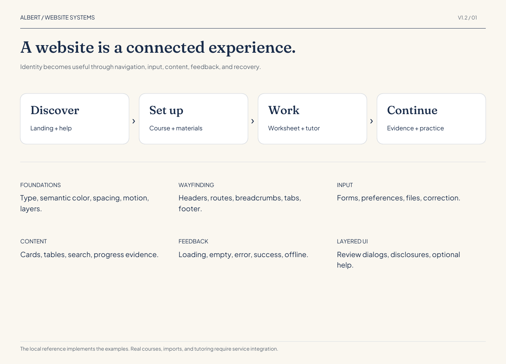
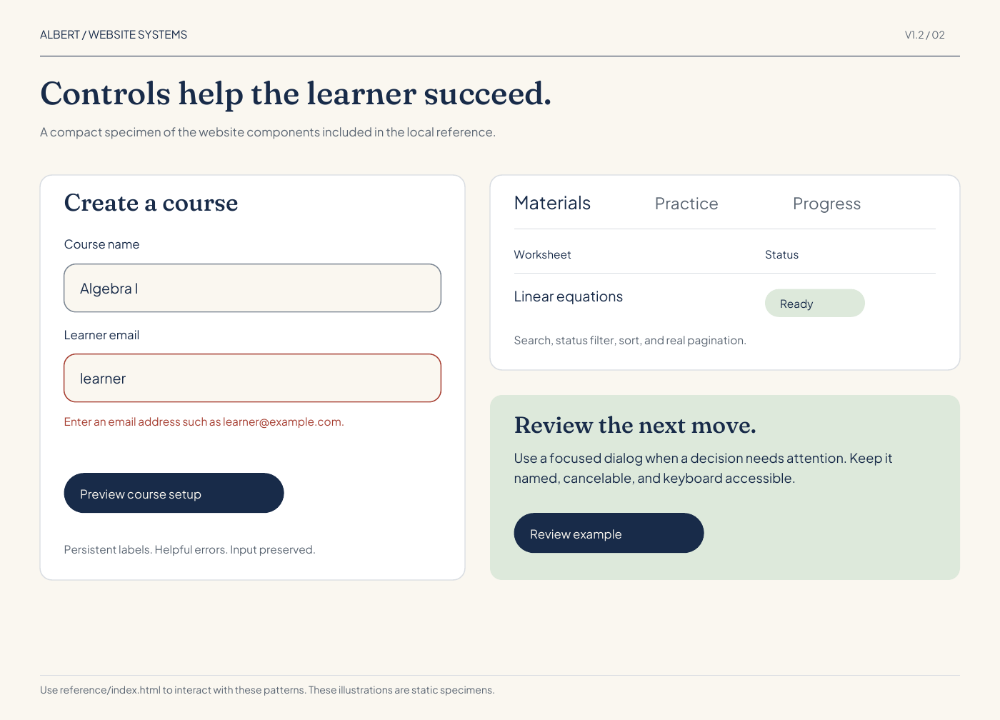
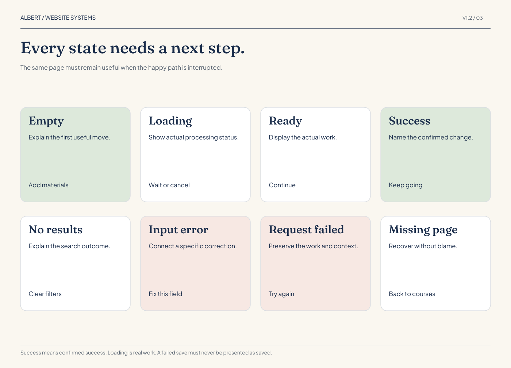
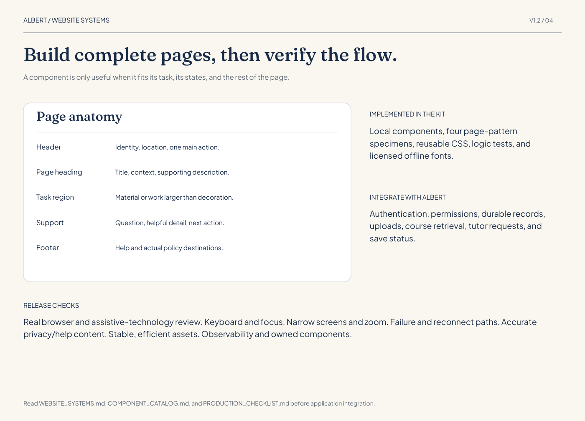

# Albert — Complete Website Design System

**Version 1.3.0 · November 15, 2026**

The brand gives Albert its identity. A complete website also needs ways to move, enter information, understand status, recover from mistakes, read content, and complete a task. This specification adds those systems while preserving the Scholar wordmark, raised coral t/plus, paper professor, and existing layout rules.

Companions: [execution plan](WEBSITE_SYSTEMS_PLAN.md) · [interactive reference](reference/index.html) · [component catalog](COMPONENT_CATALOG.md) · [illustrated website guide](WEBSITE_SYSTEMS.pdf) · [production checklist](PRODUCTION_CHECKLIST.md).

## 1. The layers of a website

| Layer | Elements | Albert's purpose |
|---|---|---|
| Identity | Name, logo, mascot, imagery, voice | A recognizable and trustworthy tutor |
| Foundations | Color roles, type, spacing, grids, corners, motion, layers | Consistent decisions across screens |
| Navigation | Header, sidebar, menu, breadcrumbs, tabs, footer | Help the learner locate and resume work |
| Input | Fields, selections, preferences, upload, validation | Gather accurate course and worksheet context |
| Content and data | Cards, lists, tables, badges, search, filters, progress | Find the right material and understand evidence |
| Feedback | Loading, empty, error, warning, success, notifications | Make system state and the next action clear |
| Layers and disclosure | Dialogs, expandable detail, optional help | Resolve focused decisions without overwhelming the page |
| Complete experiences | Landing, onboarding, course hub, workspace, progress, settings | Turn individual components into useful flows |
| Infrastructure | Authentication, permissions, storage, integrations, routing | Make the actual product operate reliably |
| Quality and maintenance | Accessibility, performance, SEO, analytics, tests, governance | Keep the experience useful as it grows |



## 2. Foundations beyond appearance

### Semantic color roles

New code should choose a role before a literal color. `action` maps to Ink, `action-on` to Paper, `surface` to Paper, `surface-raised` to White, `text` to Ink, and `text-secondary` to Muted. `success-surface` maps to Sage with Ink text. `danger-text` maps to the accessible dark coral. Information, pending, and error surfaces are quiet supporting tints, not additional primary brand colors.

Use a message or symbol with each status. A green background cannot explain success; a coral ring cannot identify the reason for an error. Preserve meaningful contrast for text, fields, focus outlines, and data marks. The contrast table in the master system still governs color pairing.

### Layers and motion

Content stays in normal document flow. Sticky application chrome uses layer 20; optional dropdown surfaces use 30; custom non-native overlays reserve 40; toasts use 50. Native modal dialogs use the browser's top layer and do not need an arbitrary huge z-index. Avoid sticky content that covers a focused field or worksheet symbol.

Use the existing 180 ms transition token for small state changes. Animate neither the whole page nor every mascot appearance. Respect `prefers-reduced-motion`; a user's in-page preference can further reduce motion. Essential instructions stay readable without animation.

### Icons and imagery

Use one consistent line-icon family, typically 18–20 px with 1.5–2 px strokes. Keep a text label for unfamiliar actions and an accessible name for icon-only controls. Icons do not replace mathematical notation. Use the mascot when a tutoring event benefits from its presence; do not decorate every list row with it. Provide image dimensions to reserve layout space and informative alt text only when the image adds information.

## 3. Information architecture and navigation

### Recommended application routes

```text
Public
  /                 Product introduction and first action
  /help             Getting started and common questions
  /accessibility    Accessibility information and contact route
  /privacy          Actual product privacy information
  /terms            Actual applicable terms

Learner application
  /courses                         Course hub and resume points
  /courses/new                     Course setup and materials
  /courses/:courseId               Course overview
  /courses/:courseId/materials     Notes and worksheets
  /practice/:worksheetId           Writing workspace and tutor
  /progress                       Skill evidence and practice plan
  /settings                       Preferences and account controls
```

These routes define the product architecture; the catalog's links are local design-reference sections. Route names can adapt to the actual application router. Deep links should restore the same course or worksheet context, subject to authorization.

### Navigation contracts

- **Main links:** use real anchors with meaningful destinations; retain browser open-in-new-tab behavior.
- **Current location:** mark the relevant destination with `aria-current="page"` or `location` as appropriate. Do not show all links as selected.
- **Breadcrumbs:** use an ordered list in a labeled nav; ancestor items are links, the current item is plain text. They show hierarchy rather than a second independent menu.
- **Tabs:** switch related views in the same context. Use `tablist`, `tab`, and `tabpanel`; one selected tab; roving tab order; Left/Right, Home, and End behavior.
- **Mobile navigation:** expose a real toggle with `aria-expanded` and `aria-controls`. Hidden links must leave the keyboard order. Preserve a useful focus destination after navigation.
- **Footer:** provide help, accessibility, and applicable policy destinations. Use real policy content and working routes before release.

Do not use a tab for a different website route unless it is implemented as actual navigation with appropriate browser behavior. Do not use a button solely to navigate to a normal page.

## 4. Forms, preferences, and materials

### Field anatomy

Use a persistent label, field, concise helper text when needed, and an adjacent error. A placeholder is an optional example, not the only label. Inputs follow the existing 48 px minimum height and 12 px corner radius. Fieldsets with legends group related radios or checkboxes. Prefer native select and file controls until a genuinely required interaction warrants a custom widget.

Choose the input type and autocomplete appropriate to its meaning. State required or optional clearly. Validate on submission; revalidate corrected fields without demanding perfection on every keystroke. Preserve entered values after an error. A failed submit should show an error summary with links to invalid fields, focus that summary, set `aria-invalid`, and connect help/error text with `aria-describedby`.

### Submission behavior

During a real asynchronous submit, keep the label recognizable, prevent duplicate requests when necessary, and expose real status. Do not mark a course as saved before the service confirms it. A server-side validation failure should produce the same field treatment as local validation. A network failure leaves the form intact and offers retry. Success names what changed and supplies the next action.

### File and course import

The reference validates PDF/PNG/JPEG selection and a 10 MB local example limit. Production limits must match the real service; the server independently validates file size and content. Accepting a filename extension in the browser is a usability check, not file security or successful upload.

The actual import flow needs: choose source → select material → upload/authorize → processing → review extracted course context → confirm readiness. Distinguish queued, uploading, processing, ready, partially imported, cancelled, and failed states. Offer file-specific errors and retry. Do not turn an arbitrary animation into a progress percentage. Ask the learner to confirm uncertain notation or course context.

### Account and preference patterns

Use clearly named preferences, explicit on/off labels for switches, and persistence feedback only after storage succeeds. Account entry and recovery should identify what action will happen, show useful errors, and preserve a return destination. The catalog has no real authentication and does not collect or send credentials. Production authentication should use the application's chosen identity service and accessible account-recovery flow.



## 5. Content and data

### Cards, lists, and tables

Use a card when an item combines a title, related metadata, status, and one main action. Use a list when items are simple and repeated; align rows instead of surrounding every value with its own box. Use a table for comparison across consistent columns. Give each table a caption or accessible name, header cells with scope, readable row spacing, and a deliberate horizontal-scroll region when narrow layouts cannot preserve comparison.

### Finding material

Search matches the relevant title and context. Filters have visible labels and a clear-reset action. Sorting updates the table header's `aria-sort` and retains the active search/filter. Pagination uses real counts, clamps the current page when filtering changes the result set, and disables unavailable previous/next actions. Announce the resulting count politely without moving focus on every keystroke. Debounce server searches and handle out-of-order results in the actual product.

The reference implements these behaviors over six labeled example rows. Empty results are different from an empty account: “No worksheets match” offers broader search or filter reset; “Your first worksheet starts here” offers adding material.

### Skills and progress

Show evidence, not invented precision. A skill summary should identify the skill, the work that supports the assessment, when that evidence was collected, and a proposed next practice step. Avoid fabricated percentages, unearned mastery badges, or interpreting time on a page as understanding. When a chart is useful, label units, provide a text summary, and preserve meaning without color alone. The package specifies this contract; it does not generate real learner assessments.

## 6. Feedback and asynchronous state matrix

| State | What to show | Next action | Mascot |
|---|---|---|---|
| Initial empty | Explain the missing content and first useful action | Add materials or start a worksheet | Welcoming |
| Loading | Stable geometry, meaningful status, optional decorative skeleton | Wait or cancel when supported | Thinking only for actual tutor processing |
| Ready | Actual content and available actions | Continue the task | Waiting or none |
| Success | Name the confirmed change or demonstrated skill | Continue | Celebrating only when learning progress is confirmed |
| No search results | Explain the filter/query outcome | Clear filters or broaden search | Usually none |
| Validation error | Summary plus specific field-level messages | Correct the linked field | Usually none |
| Processing failure | Describe what could not finish, preserve work | Retry or choose another source | Encouraging |
| Offline or disconnected | Honest connection status and save state | Retry after reconnecting | Waiting |
| Unauthorized/session expired | Clear explanation without exposing protected data | Sign in or request appropriate access | Usually none |
| Missing page | Contextual recovery, no blame | Return to courses or browse materials | Encouraging |

Use **inline messages** for local problems, **banners** for page-wide conditions, **toasts** for nonblocking confirmations, and **dialogs** for focused decisions. Important information must remain available long enough to read. The catalog's toast stays until dismissed. Loading and progress controls are explicitly manual specimens, not fake network activity.

Never imply that unsaved work is safe. “Saved” means an acknowledged write; “Saving…” means an in-flight operation; “Changes not saved” describes a failure and its recovery path. Offline support requires actual storage and synchronization behavior, not only a banner.



## 7. Dialogs, menus, and progressive disclosure

Use native `<dialog>` for focused review and confirmation. Give it an accessible title and description, choose the initial focus deliberately, keep keyboard focus in the modal, allow Escape for cancelable actions, and return focus to the invoking control when it closes. A destructive decision must name the affected item and consequences; use explicit verbs and a cancel path. Do not use a dialog for a routine success message.

Use native `<details>` for supplementary explanations. Keep instructions required to finish the task visible. A small help disclosure is often more accessible on touch devices than a hover-only tooltip. If implementing a true tooltip later, it must appear on focus as well as hover, dismiss with Escape, stay available while hovered, and contain no essential instruction that has no other representation.

For a navigation dropdown, a disclosure button and ordinary links are usually sufficient. Use an ARIA menu only when implementing the full corresponding menu keyboard pattern. Do not add menu roles to an ordinary site navigation list merely to change its appearance.

## 8. Complete-page patterns

| Page | Necessary regions | Primary action | Required non-happy states |
|---|---|---|---|
| Landing | Header, clear promise, worksheet/tutor demonstration, concrete benefits, first action, footer | Start with your course | Missing media, narrow viewport, reduced motion |
| Course hub | Page title, resume point, course list, search, add-course action | Resume or add a course | First use, filtered empty, loading, fetch error |
| Course setup | Stepper, current form, material source, review, readiness | Continue setup | Field errors, upload errors, cancelled import |
| Course overview | Course context, materials/practice/progress views, recent work | Open a worksheet | Missing material, partial import, revoked source access |
| Workspace | Writing tools, worksheet, precise annotations, tutor, step controls, save status | Work independently or ask a hint | Ambiguous handwriting, hint failure, unsaved work, reconnect |
| Progress | Skills, evidence, explanations, recommended practice | Practice a skill | Insufficient evidence, stale data, unavailable assessment |
| Settings | Account, preferences, accessibility, data controls | Save a preference | Save failure, session expiry, destructive confirmation |
| Help/policy | Clear title, navigable content, contact or applicable policy details | Find an answer/contact route | Missing content and broken destinations |
| Error/404 | Specific explanation, recovery destination | Return to a useful place | Unavailable destination or repeated error |

### Onboarding

Use a short three-step structure: **Course → Materials → Ready**. Identify the current step with text and `aria-current="step"`. Back preserves information. Continue validates the current step. Do not require irrelevant profile details before a learner can begin useful work. On reload or resuming a real setup, restore its actual saved state.

### Worksheet teaching pattern

The example progresses from a question to one worked operation, with a deliberate “Let me try” action returning Albert to waiting. The actual application supplies handwriting, course retrieval, model responses, stroke-aware annotations, and persistent progress. The surrounding design should keep the work visible and the learner in control. Never expose a generated answer simply because a loading animation finished.



## 9. Responsive and accessible behavior

Preserve the existing 12/8/4-column layout rules, but choose component reflow by content. A dense filter bar can wrap before the site-wide breakpoint. A dialog is width constrained and internally scrollable if its content exceeds the viewport. A table may scroll inside its labeled region; a page should not acquire accidental horizontal scrolling.

Every page needs semantic header/nav/main/footer regions where appropriate, a working skip link, meaningful headings, visible keyboard focus, persistent labels, and text alternatives for essential visuals. Focus must remain useful after opening, closing, replacing, or removing UI. Use polite live regions for meaningful updates and errors carefully; avoid multiple competing announcements. Reserve urgent alerts for events that need interruption.

Support a 320 px layout, zoom/reflow checks, text expansion, keyboard-only use, and reduced motion. Respect browser autofill, password managers, native selection, and normal navigation behavior. Accessibility needs verification in the integrated product with a screen reader and real browser; markup alone is not a certification.

### Content flexibility

Keep copy in a replaceable content layer. Allow longer translated labels and multi-line buttons rather than clipping them. Format dates, times, and numbers according to the learner's locale. Course mathematics and language may require different notation and directionality; confirm behavior before offering an RTL locale. Never encode a critical instruction only in an image.

## 10. What makes it a production website

| Concern | Required product work |
|---|---|
| Routing | Real destinations, deep links, reload behavior, useful 404 handling |
| Authentication | Actual identity provider, session states, account recovery, return paths |
| Authorization | Course and material access checked by the service on every protected request |
| Storage | Persistent courses, worksheets, annotations, preferences, and progress |
| Upload/import | Server-side file checks, storage, processing, errors, cancellation, source access |
| Tutor integration | Course context, real processing status, uncertainty handling, scoped responses |
| Privacy and policy content | Accurate explanations of actual collection, use, retention, and user controls |
| Performance | Optimized image derivatives, deferred noncritical UI, bounded fonts, stable layout |
| SEO and sharing | Useful public titles/descriptions, canonical URLs, sharing metadata; private data kept out of public indexing |
| Observability | Useful failure signals, import diagnostics, and service timing without logging sensitive student work unnecessarily |
| Analytics | Only events needed to understand use; actual consent/preferences honored where applicable |
| Content maintenance | Owned help/policy content and checked navigation destinations |

These concerns belong in the system because they change the visible experience. They are integration requirements, not completed services in the local reference. There is no need to add payments, a pricing page, or social features unless Albert's product actually needs them.

## 11. Component contracts and governance

Each reusable component should record purpose, anatomy, variants, sizes, states, keyboard behavior, content rules, responsive behavior, and its actual implementation status. Use the [catalog](COMPONENT_CATALOG.md) to distinguish an implemented example from a specified future integration.

Keep token names stable. Prefer semantic roles over adding a literal color to every new component. Record changes in the changelog, retain the chosen logo/mascot masters, and review new components against a real Albert task. A component is ready for application integration only after its important states and keyboard behavior have been checked. Use the [production checklist](PRODUCTION_CHECKLIST.md) for release acceptance.

## 12. Using the implementation

Open [reference/index.html](reference/index.html) from the extracted folder in a current browser. It uses local CSS, JavaScript, images, and licensed fonts and makes no API calls. Keep the folder structure intact. Its sample form, files, and table data are not persisted. It can also be served by an application's usual static development workflow.

For reusable styling, load the stylesheets in this order:

```html
<link rel="stylesheet" href="tokens/albert.fonts.css">
<link rel="stylesheet" href="tokens/albert.css">
<link rel="stylesheet" href="tokens/albert.components.css">
<link rel="stylesheet" href="tokens/albert.web.css">
```

The optional font stylesheet uses bundled OFL-licensed Fraunces and Plus Jakarta Sans files. The pure helpers in [reference/logic.js](reference/logic.js) demonstrate search, filter, sort, pagination, validation, and local file checks; [reference/app.js](reference/app.js) connects the specimens. The catalog stylesheet includes page-specific presentation, not a requirement to copy its documentation sidebar into Albert's product.

Run the included helper tests with:

```sh
node --test tests/logic.test.cjs
```

See [VERIFICATION.md](VERIFICATION.md) for the checks actually performed and the remaining browser review.
